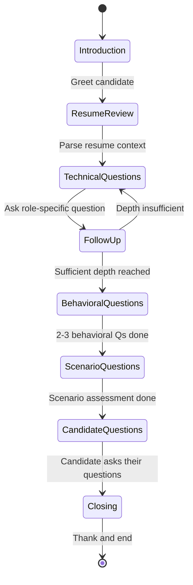
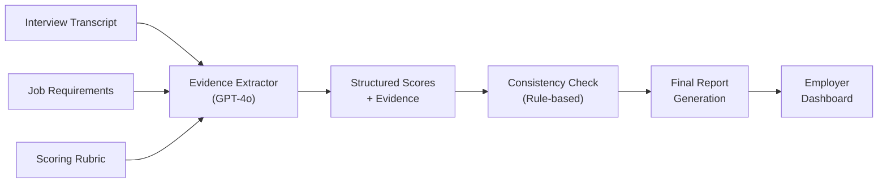
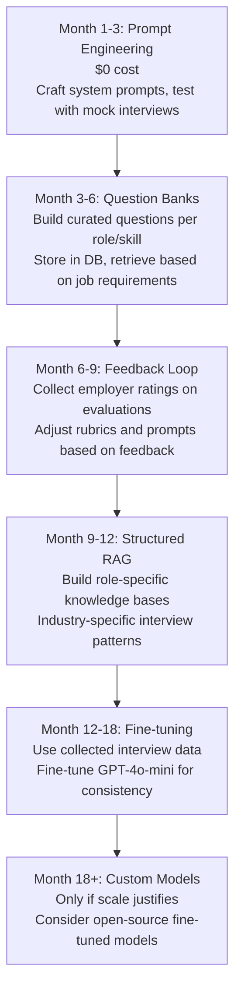
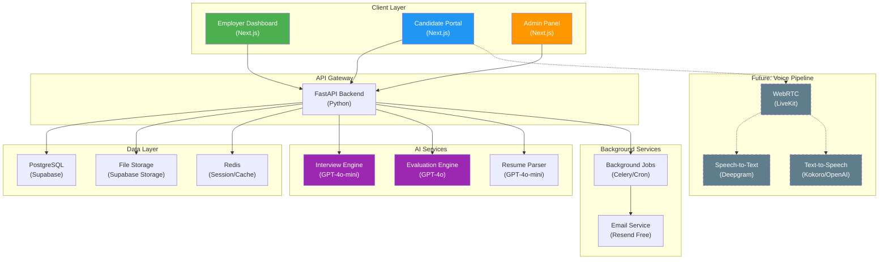
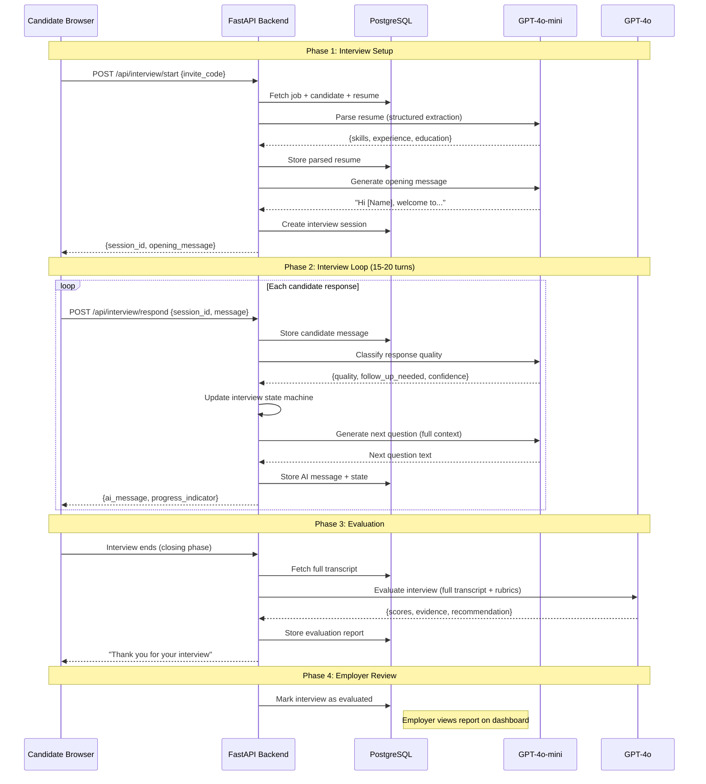
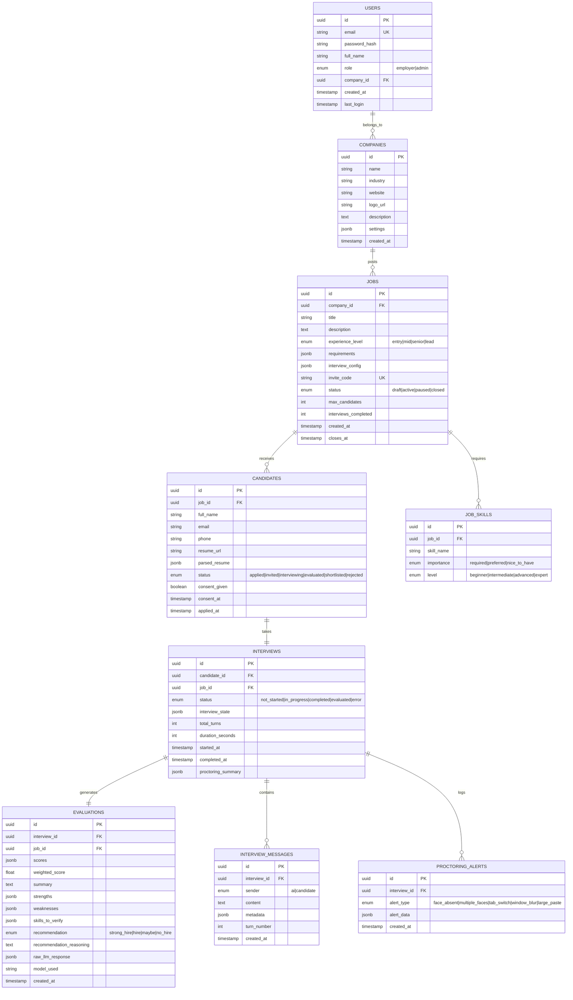

# AI-Powered Recruitment Platform — Complete Technical Blueprint

> **Codename:** HireAI (working name)
> **Date:** November 2026
> **Authors:** Technical Co-founder Blueprint
> **Status:** Pre-seed, ₹0 budget, student founders in India

---

## Table of Contents

1. [Executive Assessment](#1-executive-assessment)
2. [Mercor Business Model Analysis](#2-mercor-business-model-analysis)
3. [MVP Definition](#3-mvp-definition)
4. [Technical Stack](#4-technical-stack)
5. [AI Model Comparison](#5-ai-model-comparison)
6. [AI Interviewer Design](#6-ai-interviewer-design)
7. [Scoring System Design](#7-scoring-system-design)
8. [Video Monitoring](#8-video-monitoring)
9. [AI Customization Strategy](#9-ai-customization-strategy)
10. [System Architecture Diagrams](#10-system-architecture-diagrams)
11. [Database and API Design](#11-database-and-api-design)
12. [Infrastructure and Deployment](#12-infrastructure-and-deployment)
13. [Detailed Cost Analysis](#13-detailed-cost-analysis)
14. [12-Week Development Roadmap](#14-12-week-development-roadmap)
15. [First Seven Days](#15-first-seven-days)
16. [Validation and Testing](#16-validation-and-testing)
17. [Business Model and Go-to-Market](#17-business-model-and-go-to-market)
18. [Major Risks and Trade-offs](#18-major-risks-and-trade-offs)
19. [Final Recommended Architecture](#19-final-recommended-architecture)
20. [Immediate Next Steps](#20-immediate-next-steps)

---

## 1. Executive Assessment

### Is this business technically and commercially feasible?

**Yes, conditionally.** Here is the honest breakdown:

**Technically feasible:** The core technology stack exists today. LLMs (GPT-4o-mini, Gemini Flash, open-source Qwen/Llama) can conduct coherent multi-turn interviews. Speech-to-text (Whisper, Deepgram Nova-3) is accurate enough. Text-to-speech (Kokoro open-source, OpenAI TTS) is natural enough. You do NOT need to train a model from scratch. You do NOT need GPUs. You CAN build a working prototype for under ₹2,000/month.

**Commercially feasible:** Indian SMBs and staffing agencies spend ₹5,000–₹50,000+ per hire on screening. If you can reduce a 3-day screening process to 2 hours of AI interviews at ₹50–₹150 per interview, the unit economics work. The Indian HR-tech market is growing at ~25% CAGR.

**Critical challenges I must be honest about:**

| Challenge | Severity | Mitigation |
|-----------|----------|------------|
| AI scoring accuracy is NOT validated | 🔴 Critical | Must be positioned as "screening assistance" not "automated decisions" |
| Competing with HireVue ($35K+/yr), Interviewer.ai, Talview | 🟡 Medium | They target enterprise; you target Indian SMBs at 1/100th the price |
| 20-30 min voice interviews cost ₹15-80 each in API calls | 🟡 Medium | Start text-based, add voice for paying customers |
| You have no brand, no customers, no funding | 🟡 Medium | Normal for pre-seed; solve with free pilots |
| Legal risk of AI-based hiring decisions in India | 🟡 Medium | DPDP Act compliance; always human-in-the-loop |

**My verdict:** Build it. But build it as a **screening assistant** (not an automated hiring tool), start **text-based** (not voice), target **Indian IT staffing agencies** first, and charge per-interview. Your first goal is 5 paying customers within 6 months, not a perfect product.

---

## 2. Mercor Business Model Analysis

### What Mercor Actually Does (as of 2025-2026)

Mercor evolved from an AI-powered recruiter into an **Expert-as-a-Service (EaaS) platform** primarily serving frontier AI labs. Their business model:

| Aspect | Mercor's Model | Our Model |
|--------|---------------|-----------|
| **Primary Revenue** | Hourly billing for expert contractors (RLHF, data annotation) | Per-interview SaaS fees from employers |
| **Take Rate** | ~30-40% of contractor billing | 100% of interview fee (we don't employ candidates) |
| **Target Customer** | Fortune 500, AI labs (OpenAI, Google) | Indian SMBs, staffing agencies, mid-market companies |
| **Pricing** | $50-200+/hr per expert + 30% placement fees | ₹50-500 per AI interview |
| **Core Tech** | AI-powered vetting, global payroll, compliance | AI interviewer, structured evaluation, candidate ranking |
| **Scale** | Millions of contractors, billions in GMV | Start with 100 candidates/month |
| **Funding** | $100M+ raised (Series B) | ₹0 |

### What We Borrow Conceptually

1. **AI-powered candidate screening** — using LLMs to assess candidates instead of keyword-matching
2. **Structured interview + evaluation pipeline** — consistent scoring across candidates
3. **Two-sided marketplace thinking** — employers post jobs, candidates get interviewed

### How We Differentiate

1. **Price point:** 100x cheaper than HireVue/Talview. Affordable for a 10-person company hiring 2 developers
2. **India-first:** Rupee pricing, Indian languages support (Hindi, regional), understanding of Indian job market
3. **Transparency:** Explainable scores with interview evidence, not black-box AI ratings
4. **Anti-ATS philosophy:** Give every applicant a fair interview opportunity, not just resume keyword matches
5. **SMB-friendly:** No annual contracts, no enterprise sales cycle, self-serve sign-up

---

## 3. MVP Definition

### The Smallest Credible Product

> [!IMPORTANT]
> The MVP is NOT a voice/video AI interviewer. The MVP is a **text-based AI interview chatbot** with structured evaluation. Voice comes in Phase 4.

**MVP Feature Set (Build This First):**

| Feature | Description | Priority |
|---------|-------------|----------|
| Employer sign-up | Email/password auth, company profile | P0 |
| Job creation | Title, description, required skills, experience level | P0 |
| Interview configuration | Number of questions, focus areas, difficulty | P0 |
| Candidate invite link | Unique URL per job, no candidate account needed initially | P0 |
| Resume upload + parsing | PDF/DOCX upload, extract skills/experience via LLM | P0 |
| Text-based AI interview | 10-15 question adaptive chat interview, 15-20 min | P0 |
| Evaluation report | Structured scores + evidence + summary | P0 |
| Employer dashboard | View candidates, read reports, compare scores | P0 |
| Interview transcript | Full conversation record | P0 |

**Explicitly NOT in MVP:**

- ❌ Voice/video interviews
- ❌ Video proctoring
- ❌ Payment system (first 5 customers are free pilots)
- ❌ Candidate accounts/profiles
- ❌ Multi-language support
- ❌ Mobile app
- ❌ ATS integrations
- ❌ Custom branding
- ❌ Analytics/reporting beyond basic scores

### Why Text-Based First?

| Reason | Details |
|--------|---------|
| **Cost** | Text interview costs ₹2-5 per interview vs ₹15-80 for voice |
| **Latency** | No STT/TTS latency issues to solve |
| **Reliability** | No microphone/audio issues, works on any device |
| **Development speed** | 3-4 weeks to prototype vs 8-12 weeks for voice |
| **Candidate accessibility** | Works in noisy environments, for hearing-impaired candidates |
| **Iteration speed** | Easy to tune prompts, see exact inputs/outputs |

**When to add voice:** Only after you have 3+ paying customers who specifically request it AND you can afford ₹3,000-5,000/month in API costs.


---

## 4. Technical Stack

### Recommended Stack (Primary Choice)

| Layer | Technology | Why This |
|-------|-----------|----------|
| **Frontend** | Next.js 14+ (React) + TypeScript | Free, SSR for SEO, great DX, huge ecosystem |
| **CSS/UI** | Tailwind CSS + shadcn/ui | Free, fast to build professional UIs |
| **Backend** | Python FastAPI | Best LLM ecosystem, async support, fast |
| **Database** | PostgreSQL via Supabase | Free tier: 500MB, built-in auth, storage, realtime |
| **Auth** | Supabase Auth | Free tier: 50K MAUs, email/password + OAuth |
| **File Storage** | Supabase Storage | Free tier: 1GB, resume PDFs |
| **LLM (Interview)** | GPT-4o-mini (primary) / Gemini Flash-Lite (backup) | Cheapest quality LLMs: $0.15/$0.60 per M tokens |
| **LLM (Evaluation)** | GPT-4o (separate, stronger model) | Better reasoning for scoring: $2.50/$10 per M tokens |
| **Resume Parsing** | GPT-4o-mini + structured output | Cheaper than dedicated parsers |
| **Hosting (Frontend)** | Vercel (free tier) | Free for hobby projects, great Next.js support |
| **Hosting (Backend)** | Railway ($5/mo hobby) or self-host on VPS | Cheapest Python hosting |
| **Background Jobs** | Celery + Redis (or simple cron) | Free with self-hosted Redis |
| **Monitoring** | Sentry (free tier) + custom logging | Free tier: 5K errors/month |
| **Version Control** | GitHub (free) | Standard |
| **CI/CD** | GitHub Actions (free tier) | 2,000 min/month free |

### Alternatives Compared

| Component | Primary | Alternative 1 | Alternative 2 | Why Not Alternative |
|-----------|---------|--------------|--------------|-------------------|
| Frontend | Next.js | SvelteKit | Vue/Nuxt | Smaller ecosystem, fewer devs |
| Backend | FastAPI | Node.js/Express | Django | Express lacks typing; Django too heavy |
| Database | Supabase (Postgres) | PlanetScale (MySQL) | Neon (Postgres) | Supabase has more free features |
| LLM | GPT-4o-mini | Gemini Flash-Lite | Llama 3.1 8B (self-hosted) | Gemini: higher latency from India; Llama: needs GPU |
| Hosting | Vercel + Railway | Render | Fly.io | Render DB expires in 30 days; Fly.io more complex |

### Why This Stack for Your Constraints

1. **Cost: ₹0-500/month for prototype.** Vercel free, Supabase free, GPT-4o-mini costs only during actual interviews
2. **Speed: 2 people can build MVP in 6-8 weeks.** Next.js + FastAPI is the most productive stack for AI apps
3. **Scaling path: No rewrite needed.** Same stack scales to 10,000 interviews/month. Supabase Pro is $25/mo, Railway scales linearly
4. **LLM ecosystem: Python has the best AI libraries.** LangChain, LlamaIndex, OpenAI SDK, instructor (structured output)

---

## 5. AI Model Comparison

### LLM Models for Interviewing

| Model | Input Cost/1M tokens | Output Cost/1M tokens | Context Window | Quality for Interviews | Latency | Recommendation |
|-------|----------------------|----------------------|----------------|----------------------|---------|---------------|
| **GPT-4o-mini** | $0.15 | $0.60 | 128K | ★★★★☆ Good | Low | ✅ **Primary choice** |
| **Gemini Flash-Lite** | $0.10-0.30 | ~$0.30-1.00 | 1M | ★★★☆☆ Decent | Medium | ✅ Backup/cost reduction |
| **GPT-4o** | $2.50 | $10.00 | 128K | ★★★★★ Excellent | Low | ⚠️ Evaluation only |
| **Claude Sonnet** | $3.00 | $15.00 | 200K | ★★★★★ Excellent | Medium | ❌ Too expensive for interviews |
| **Llama 3.1 8B** | Free (self-host) | Free (self-host) | 128K | ★★★☆☆ Decent | Depends | ❌ Needs GPU ($15-50/mo min) |
| **Qwen 2.5 7B** | Free (self-host) | Free (self-host) | 128K | ★★★☆☆ Decent | Depends | ❌ Same GPU problem |

> [!TIP]
> **My decision: GPT-4o-mini for conducting interviews, GPT-4o for evaluation scoring.** The cost difference is justified because evaluation happens once per interview (small token count) while the interview conversation uses many more tokens. Using a stronger model for scoring improves consistency.

### Speech-to-Text (For Voice Phase — Later)

| Model | Cost | Quality | Latency | Self-Hostable | Recommendation |
|-------|------|---------|---------|---------------|---------------|
| **Whisper (OpenAI API)** | $0.006/min ($0.36/hr) | ★★★★☆ | Batch only | ✅ (open-source) | ✅ Cheapest cloud option |
| **Deepgram Nova-3** | $0.0043/min ($0.26/hr) | ★★★★★ | Real-time streaming | ❌ | ✅ Best for real-time |
| **faster-whisper (self-hosted)** | Free (needs GPU) | ★★★★☆ | Near real-time | ✅ | ⚠️ Only if you have a GPU |
| **Google Speech-to-Text** | $0.006-0.009/min | ★★★★☆ | Real-time | ❌ | ⚠️ More complex setup |

**My decision for voice phase:** Start with **Deepgram Nova-3** (streaming, low latency, $200 free credits). Fall back to **Whisper API** for batch processing of recorded interviews.

### Text-to-Speech (For Voice Phase — Later)

| Model | Cost | Quality | Latency | Self-Hostable | Recommendation |
|-------|------|---------|---------|---------------|---------------|
| **Kokoro (open-source)** | Free | ★★★★☆ | Medium | ✅ | ✅ **Best free option** |
| **OpenAI TTS (tts-1)** | $15/1M chars | ★★★★☆ | Low | ❌ | ✅ Best cheap cloud option |
| **Deepgram Aura-2** | $30-45/1M chars | ★★★★★ | Very low | ❌ | ⚠️ Good but 2x OpenAI cost |
| **ElevenLabs** | $240-300/1M chars | ★★★★★ | Low | ❌ | ❌ Way too expensive |
| **Fish Audio** | $5/1M chars | ★★★★☆ | Medium | ❌ | ✅ Cheapest quality cloud |
| **Cartesia Sonic** | From $4/mo | ★★★★★ | Ultra-low | ❌ | ✅ Best for voice agents |

**My decision for voice phase:** **Kokoro (self-hosted, free)** for prototype. **OpenAI TTS or Cartesia** for production when you have revenue.

### Cost Per Interview — Token Estimation

A 20-minute text interview involves approximately:
- **Candidate messages:** ~2,000-3,000 words → ~3,000-4,500 tokens
- **AI interviewer responses:** ~1,500-2,500 words → ~2,000-3,500 tokens
- **System prompt + resume context:** ~1,500-2,500 tokens
- **Cumulative context (re-sent each turn):** Average ~15 turns × growing context
- **Total input tokens per interview:** ~30,000-50,000 tokens
- **Total output tokens per interview:** ~3,000-5,000 tokens
- **Evaluation (separate call):** ~5,000 input + ~2,000 output tokens

**Cost breakdown per text interview (GPT-4o-mini + GPT-4o eval):**

| Component | Tokens | Cost |
|-----------|--------|------|
| Interview input (GPT-4o-mini) | ~40,000 | $0.006 |
| Interview output (GPT-4o-mini) | ~4,000 | $0.0024 |
| Evaluation input (GPT-4o) | ~5,000 | $0.0125 |
| Evaluation output (GPT-4o) | ~2,000 | $0.02 |
| **Total per text interview** | | **~$0.04 (₹3.4)** |

**Cost breakdown per 25-min voice interview (future):**

| Component | Cost |
|-----------|------|
| LLM (same as text) | $0.04 |
| STT — Deepgram 25 min | $0.11 |
| TTS — OpenAI ~3,000 chars/response × 15 responses | $0.68 |
| TTS — Kokoro (self-hosted) | $0.00 |
| **Total (cloud TTS)** | **~$0.83 (₹70)** |
| **Total (self-hosted TTS)** | **~$0.15 (₹12.7)** |


---

## 6. AI Interviewer Design

### Architecture Overview

The AI interviewer is NOT a simple chatbot. It is a **state-machine-driven conversational agent** with structured interview phases, adaptive questioning, and context memory.



### Interview State Machine

The interview progresses through defined phases. Each phase has entry/exit criteria, target question counts, and fallback behavior.

```python
# interview_state.py — Core interview state machine

from enum import Enum
from dataclasses import dataclass, field
from typing import Optional

class InterviewPhase(Enum):
    INTRODUCTION = "introduction"
    RESUME_REVIEW = "resume_review"
    TECHNICAL_CORE = "technical_core"
    TECHNICAL_DEEP = "technical_deep_dive"
    BEHAVIORAL = "behavioral"
    SCENARIO = "scenario_problem_solving"
    CANDIDATE_QUESTIONS = "candidate_questions"
    CLOSING = "closing"

@dataclass
class PhaseConfig:
    min_questions: int
    max_questions: int
    target_duration_minutes: float
    transition_criteria: str

PHASE_CONFIGS = {
    InterviewPhase.INTRODUCTION: PhaseConfig(0, 0, 1.0, "Always auto-advance after greeting"),
    InterviewPhase.RESUME_REVIEW: PhaseConfig(1, 2, 2.0, "Clarify resume gaps or highlights"),
    InterviewPhase.TECHNICAL_CORE: PhaseConfig(3, 5, 8.0, "Cover primary required skills"),
    InterviewPhase.TECHNICAL_DEEP: PhaseConfig(1, 3, 5.0, "Probe depth on strongest claim"),
    InterviewPhase.BEHAVIORAL: PhaseConfig(2, 3, 4.0, "STAR method questions"),
    InterviewPhase.SCENARIO: PhaseConfig(1, 2, 4.0, "Real-world problem solving"),
    InterviewPhase.CANDIDATE_QUESTIONS: PhaseConfig(0, 1, 2.0, "Invite candidate questions"),
    InterviewPhase.CLOSING: PhaseConfig(0, 0, 1.0, "Thank and close"),
}

@dataclass
class InterviewState:
    phase: InterviewPhase = InterviewPhase.INTRODUCTION
    questions_in_phase: int = 0
    total_questions: int = 0
    total_turns: int = 0
    skills_covered: list = field(default_factory=list)
    skills_remaining: list = field(default_factory=list)
    follow_up_depth: int = 0  # 0=initial, 1=follow-up, 2=deep probe
    candidate_struggled: list = field(default_factory=list)
    candidate_strong: list = field(default_factory=list)
    evidence_collected: list = field(default_factory=list)
    should_end: bool = False
    
    def should_advance_phase(self) -> bool:
        config = PHASE_CONFIGS[self.phase]
        return self.questions_in_phase >= config.min_questions
    
    def next_phase(self) -> InterviewPhase:
        phases = list(InterviewPhase)
        current_idx = phases.index(self.phase)
        if current_idx < len(phases) - 1:
            return phases[current_idx + 1]
        return InterviewPhase.CLOSING
```

### System Prompt Architecture

The system prompt is the most critical piece. It must be **long, specific, and structured**. Here is the production-grade system prompt:

```python
# prompts/interviewer.py

def build_interviewer_prompt(
    job_title: str,
    job_description: str,
    required_skills: list[str],
    experience_level: str,
    candidate_name: str,
    resume_summary: str,
    interview_state: dict,
    evaluation_criteria: list[dict],
) -> str:
    return f"""You are an experienced, professional job interviewer conducting a 
structured interview for the position of {job_title}.

## YOUR IDENTITY
- You are a senior hiring manager with deep expertise in the relevant domain.
- Your name is "Alex" (gender-neutral).
- You are warm but professional. Not robotic, not overly casual.
- You NEVER reveal that you are an AI unless directly asked, in which case 
  you say: "I'm an AI interviewer designed to give every candidate a fair, 
  structured evaluation."

## JOB CONTEXT
- Position: {job_title}
- Experience Level: {experience_level}
- Required Skills: {', '.join(required_skills)}
- Job Description: {job_description}

## CANDIDATE CONTEXT
- Candidate Name: {candidate_name}
- Resume Summary: {resume_summary}

## CURRENT INTERVIEW STATE
- Current Phase: {interview_state['phase']}
- Questions asked this phase: {interview_state['questions_in_phase']}
- Total questions asked: {interview_state['total_questions']}
- Skills already covered: {interview_state['skills_covered']}
- Skills remaining: {interview_state['skills_remaining']}
- Areas where candidate struggled: {interview_state['candidate_struggled']}
- Areas where candidate was strong: {interview_state['candidate_strong']}

## INTERVIEW RULES — FOLLOW EXACTLY

### Questioning Strategy
1. Ask ONE question at a time. Never ask multiple questions in one message.
2. Start with an open-ended question about the skill, then narrow down based 
   on the answer.
3. If the candidate gives a vague answer, ask a SPECIFIC follow-up: 
   "Can you walk me through exactly how you implemented that?" or 
   "What specific challenges did you face?"
4. If the candidate gives a wrong answer, do NOT correct them. Note it 
   internally and move to the next topic.
5. If the candidate says "I don't know," acknowledge it professionally and 
   move on: "That's perfectly fine. Let's talk about..."
6. Adapt difficulty: If the candidate answers well, increase complexity. 
   If they struggle, ask a simpler related question before moving on.

### Follow-up Logic
- Level 0 (Initial): Broad question about the skill
  Example: "Tell me about your experience with Python."
- Level 1 (Follow-up): Specific application question
  Example: "You mentioned using Django. How did you handle database 
  migrations in a team environment?"
- Level 2 (Deep probe): Implementation/debugging detail
  Example: "If a migration conflicted with a teammate's changes, how 
  would you resolve that?"
- Maximum 2 follow-ups per topic, then move to next skill.

### What NOT to Do
- Do NOT ask textbook definition questions ("What is polymorphism?")
- Do NOT ask trick questions or gotchas
- Do NOT make assumptions about the candidate's knowledge based on demographics
- Do NOT comment on the candidate's resume gaps negatively
- Do NOT ask about age, marital status, religion, disability, or other 
  protected characteristics
- Do NOT hallucinate the candidate's previous answers — only reference 
  what they actually said
- Do NOT score or evaluate during the interview — just gather evidence

### Conversation Style
- Use the candidate's name occasionally (not every message)
- Keep your messages under 100 words unless asking a scenario question
- Use natural transitions: "That's interesting. Building on that..."
- Show active listening: Reference their specific words
- If the candidate goes off-topic, gently redirect

### Phase Transitions
- Introduction → Resume Review: After greeting
- Resume Review → Technical: After 1-2 resume questions
- Technical Core → Technical Deep: After covering 3+ required skills
- Technical Deep → Behavioral: After probing depth on 1-2 topics
- Behavioral → Scenario: After 2-3 STAR-method questions
- Scenario → Candidate Questions: After 1-2 problem-solving tasks
- Candidate Questions → Closing: After addressing their questions

## EVALUATION CRITERIA (Gather evidence for these)
{chr(10).join([f"- {c['name']}: {c['description']}" for c in evaluation_criteria])}

## OUTPUT FORMAT
Respond with ONLY your next interview message. Be natural and conversational. 
Do NOT include any metadata, scores, or internal notes in your response.
"""
```

### Adaptive Follow-Up Logic

The follow-up system is what separates a good AI interviewer from a questionnaire:

```python
# interview_engine.py

import json
from openai import OpenAI

client = OpenAI()

async def classify_response(
    question: str, 
    answer: str, 
    skill: str
) -> dict:
    """Classify candidate response quality to determine follow-up strategy."""
    
    response = client.chat.completions.create(
        model="gpt-4o-mini",
        response_format={"type": "json_object"},
        messages=[{
            "role": "system",
            "content": """Analyze this interview Q&A. Return JSON:
{
    "answer_quality": "strong|adequate|weak|irrelevant|uncertain",
    "demonstrates_practical_knowledge": true/false,
    "demonstrates_theoretical_only": true/false,
    "specific_evidence_given": true/false,
    "follow_up_needed": true/false,
    "follow_up_type": "deeper_probe|clarification|simpler_question|none",
    "key_claims": ["claim1", "claim2"],
    "skill_confidence": 0.0-1.0
}"""
        }, {
            "role": "user",
            "content": f"Skill: {skill}\nQuestion: {question}\nAnswer: {answer}"
        }],
        temperature=0.1  # Low temperature for consistent classification
    )
    
    return json.loads(response.choices[0].message.content)


async def generate_next_question(
    interview_state: InterviewState,
    conversation_history: list[dict],
    response_classification: dict,
    job_context: dict,
    resume_context: str,
) -> str:
    """Generate the next interview question based on state and response quality."""
    
    # Update state based on classification
    if response_classification["answer_quality"] == "strong":
        interview_state.candidate_strong.append(
            interview_state.skills_remaining[0] if interview_state.skills_remaining else "general"
        )
    elif response_classification["answer_quality"] in ["weak", "uncertain"]:
        interview_state.candidate_struggled.append(
            interview_state.skills_remaining[0] if interview_state.skills_remaining else "general"
        )
    
    # Decide follow-up vs new topic
    if (response_classification["follow_up_needed"] 
        and interview_state.follow_up_depth < 2):
        interview_state.follow_up_depth += 1
    else:
        # Move to next skill
        if interview_state.skills_remaining:
            covered = interview_state.skills_remaining.pop(0)
            interview_state.skills_covered.append(covered)
        interview_state.follow_up_depth = 0
        interview_state.questions_in_phase += 1
    
    # Check phase transition
    if interview_state.should_advance_phase():
        interview_state.phase = interview_state.next_phase()
        interview_state.questions_in_phase = 0
    
    # Generate next question using full context
    system_prompt = build_interviewer_prompt(
        job_title=job_context["title"],
        job_description=job_context["description"],
        required_skills=job_context["skills"],
        experience_level=job_context["experience_level"],
        candidate_name=job_context["candidate_name"],
        resume_summary=resume_context,
        interview_state=interview_state.__dict__,
        evaluation_criteria=job_context["evaluation_criteria"],
    )
    
    response = client.chat.completions.create(
        model="gpt-4o-mini",
        messages=[
            {"role": "system", "content": system_prompt},
            *conversation_history,
        ],
        temperature=0.7,
        max_tokens=300,
    )
    
    return response.choices[0].message.content
```

### Context Management Strategy

For a 20-minute interview with ~15 turns, context grows rapidly. Strategy:

1. **Full conversation history** in messages array (GPT-4o-mini's 128K context handles this easily)
2. **Resume summary** (not full resume) in system prompt — ~500 tokens
3. **Interview state** updated after each turn — included in system prompt
4. **Response classification** runs as a separate lightweight call — keeps interviewer prompt clean
5. **No RAG needed for MVP** — the system prompt + conversation history fits within context

> [!NOTE]
> You do NOT need RAG for the MVP. A 20-minute interview generates ~8,000-12,000 tokens of conversation, well within any modern LLM's context window. RAG becomes useful only when you have a question bank of 10,000+ questions or need to reference company-specific documentation during interviews.

### Multi-Agent vs Single-Agent Decision

**Decision: Single agent for MVP. Multi-agent is unnecessary complexity.**

| Approach | Pros | Cons | Verdict |
|----------|------|------|---------|
| Single LLM call per turn | Simple, fast, cheap | All logic in one prompt | ✅ **Use this** |
| Interviewer + Classifier (2 calls) | Better follow-up logic | 2x API calls | ✅ **Use this** |
| Full multi-agent (interviewer + evaluator + moderator + fact-checker) | Most sophisticated | 4-5x cost, complex orchestration, latency | ❌ Overkill |

**Recommended architecture: 2 calls per turn**
1. **Interviewer LLM** (GPT-4o-mini) — generates the next question
2. **Response Classifier** (GPT-4o-mini) — classifies answer quality for state updates

The evaluation/scoring happens AFTER the interview ends, not during.


---

## 7. Scoring System Design

### Evaluation Architecture

> [!IMPORTANT]
> The evaluation model should be DIFFERENT from the interviewer model. Use a stronger model (GPT-4o) for evaluation to improve consistency and reasoning quality. The evaluation runs ONCE after the interview ends — the cost is minimal.



### Scoring Rubric Design

Each competency has a **detailed rubric** with behavioral anchors at each score level. This is critical for consistency.

```python
# scoring/rubrics.py

SCORING_RUBRICS = {
    "technical_expertise": {
        "name": "Technical / Domain Expertise",
        "description": "Depth and breadth of knowledge in required technical skills",
        "weight": 0.25,
        "anchors": {
            1: "Cannot explain basic concepts. No relevant experience demonstrated.",
            2: "Superficial understanding. Uses buzzwords without substance.",
            3: "Knows basic concepts but cannot apply them to real scenarios.",
            4: "Understands fundamentals and can describe simple applications.",
            5: "Solid working knowledge. Can describe real projects with specifics.",
            6: "Good practical knowledge. Identifies trade-offs and alternatives.",
            7: "Strong expertise. Explains complex implementations clearly.",
            8: "Deep expertise. Handles edge cases, debugging scenarios well.",
            9: "Expert level. Demonstrates architectural thinking and best practices.",
            10: "Exceptional. Teaching-level mastery with novel insights.",
        },
        "evidence_required": True,
        "minimum_questions": 2,
    },
    "communication": {
        "name": "Communication Skills",
        "description": "Clarity, structure, and effectiveness of verbal/written communication",
        "weight": 0.15,
        "anchors": {
            1: "Incoherent or unresponsive.",
            2: "Very difficult to understand. Extremely disorganized.",
            3: "Understandable but unfocused. Frequent tangents.",
            4: "Basic clarity but lacks structure. Some rambling.",
            5: "Clear communication. Answers the question asked.",
            6: "Well-structured responses. Good use of examples.",
            7: "Articulate and concise. Explains complex topics simply.",
            8: "Excellent communicator. Structured, clear, and engaging.",
            9: "Outstanding. Adapts explanation depth to audience.",
            10: "Exceptional. Could present to any audience effectively.",
        },
        "evidence_required": False,  # Assessed holistically
        "minimum_questions": 0,
    },
    "problem_solving": {
        "name": "Problem-Solving Skills",
        "description": "Ability to analyze problems, consider approaches, and reason through solutions",
        "weight": 0.20,
        "anchors": {
            1: "Cannot engage with problems. No analytical thinking.",
            3: "Attempts to solve but approach is disorganized or incorrect.",
            5: "Can solve straightforward problems with standard approaches.",
            7: "Considers multiple approaches. Identifies edge cases.",
            9: "Systematic problem decomposition. Creative and thorough.",
            10: "Exceptional analytical reasoning. Identifies non-obvious solutions.",
        },
        "evidence_required": True,
        "minimum_questions": 1,
    },
    "relevant_experience": {
        "name": "Relevant Experience",
        "description": "Quality and relevance of past work experience to this role",
        "weight": 0.15,
        "anchors": {
            1: "No relevant experience at all.",
            3: "Minimal relevant experience. Mostly academic or unrelated.",
            5: "Some relevant experience. Can describe relevant projects.",
            7: "Strong relevant experience. Multiple applicable projects.",
            9: "Extensive directly relevant experience. Leadership roles.",
            10: "Perfect experience match. Deep domain expertise.",
        },
        "evidence_required": True,
        "minimum_questions": 1,
    },
    "reasoning_quality": {
        "name": "Quality of Reasoning",
        "description": "Logical thinking, ability to justify decisions, and intellectual honesty",
        "weight": 0.10,
        "anchors": {
            1: "Contradictory or illogical statements throughout.",
            3: "Some logical gaps. Cannot justify decisions.",
            5: "Generally logical. Can explain reasoning when prompted.",
            7: "Strong reasoning. Considers trade-offs and alternatives.",
            9: "Excellent. Acknowledges uncertainty, reasons from principles.",
            10: "Exceptional intellectual rigor and honesty.",
        },
        "evidence_required": False,
        "minimum_questions": 0,
    },
    "job_fit": {
        "name": "Job-Specific Competencies",
        "description": "Alignment with specific requirements of this particular role",
        "weight": 0.10,
        "anchors": {
            1: "No alignment with job requirements.",
            5: "Partial alignment. Meets some requirements.",
            7: "Good alignment. Meets most core requirements.",
            10: "Perfect fit. Exceeds all stated requirements.",
        },
        "evidence_required": True,
        "minimum_questions": 1,
    },
    "overall_suitability": {
        "name": "Overall Role Suitability",
        "description": "Holistic assessment of candidate fit for this specific position",
        "weight": 0.05,
        "anchors": {
            1: "Strongly not recommended.",
            3: "Below expectations for this role.",
            5: "Meets minimum requirements. Could perform adequately.",
            7: "Good candidate. Would perform well.",
            9: "Excellent candidate. Strong hire recommendation.",
            10: "Exceptional. Top candidate.",
        },
        "evidence_required": False,
        "minimum_questions": 0,
    },
}
```

### Evaluation Prompt (GPT-4o)

```python
# scoring/evaluator.py

def build_evaluation_prompt(
    job_context: dict,
    transcript: list[dict],
    rubrics: dict,
) -> str:
    rubric_text = ""
    for key, rubric in rubrics.items():
        rubric_text += f"\n### {rubric['name']} (Weight: {rubric['weight']})\n"
        rubric_text += f"{rubric['description']}\n"
        rubric_text += "Score anchors:\n"
        for score, description in rubric['anchors'].items():
            rubric_text += f"  {score}: {description}\n"
    
    transcript_text = "\n".join([
        f"{'Interviewer' if m['role'] == 'assistant' else 'Candidate'}: {m['content']}"
        for m in transcript
    ])
    
    return f"""You are an expert hiring evaluator. Analyze this interview transcript 
and produce a structured evaluation.

## JOB CONTEXT
- Position: {job_context['title']}
- Required Skills: {', '.join(job_context['skills'])}
- Experience Level: {job_context['experience_level']}
- Job Description: {job_context['description']}

## SCORING RUBRICS
{rubric_text}

## INTERVIEW TRANSCRIPT
{transcript_text}

## EVALUATION RULES — CRITICAL
1. Score ONLY based on evidence from the transcript. Do not infer skills not demonstrated.
2. If insufficient evidence exists for a competency, set confidence to "low" 
   and score to null. Do NOT guess.
3. Cite specific quotes from the candidate's answers as evidence.
4. Two candidates giving equally strong answers MUST receive the same score, 
   regardless of their resume background.
5. Do not penalize non-native speakers for grammar if their meaning is clear.
6. Do not penalize candidates for answering "I don't know" — that shows honesty.
7. Score each competency independently. A low technical score should not 
   automatically lower communication score.
8. Be calibrated: a score of 7 should mean the same thing across all interviews.

## OUTPUT FORMAT — Return EXACTLY this JSON structure:
{{
    "scores": {{
        "technical_expertise": {{
            "score": <1-10 or null>,
            "confidence": "high|medium|low",
            "evidence": ["quote1 from candidate", "quote2"],
            "strengths": ["strength1"],
            "weaknesses": ["weakness1"],
            "notes": "brief explanation of score"
        }},
        "communication": {{ ... same structure ... }},
        "problem_solving": {{ ... }},
        "relevant_experience": {{ ... }},
        "reasoning_quality": {{ ... }},
        "job_fit": {{ ... }},
        "overall_suitability": {{ ... }}
    }},
    "weighted_score": <calculated 1-10>,
    "summary": "2-3 sentence candidate summary",
    "top_strengths": ["strength1", "strength2", "strength3"],
    "key_concerns": ["concern1", "concern2"],
    "skills_needing_verification": ["skill1"],
    "recommendation": "strong_hire|hire|maybe|no_hire",
    "recommendation_reasoning": "why this recommendation",
    "next_steps": "suggested next interview focus areas",
    "insufficient_evidence_areas": ["area1 if any"]
}}
"""
```

### Example Evaluation Output JSON

```json
{
    "scores": {
        "technical_expertise": {
            "score": 7,
            "confidence": "high",
            "evidence": [
                "Candidate described implementing a Redis caching layer that reduced API response times from 800ms to 120ms",
                "Correctly explained the trade-offs between SQL and NoSQL for their e-commerce project",
                "Could not explain database indexing strategies beyond basic primary keys"
            ],
            "strengths": ["Strong practical Python/Django experience", "Good system design intuition"],
            "weaknesses": ["Database optimization knowledge is surface-level"],
            "notes": "Solid mid-level backend developer. Strong on application layer, weaker on infrastructure."
        },
        "communication": {
            "score": 8,
            "confidence": "high",
            "evidence": [],
            "strengths": ["Clear and structured answers", "Good use of specific examples"],
            "weaknesses": [],
            "notes": "Excellent communicator. Explains technical concepts clearly."
        },
        "problem_solving": {
            "score": 6,
            "confidence": "medium",
            "evidence": [
                "Proposed a reasonable approach to the API rate-limiting scenario but didn't consider edge cases"
            ],
            "strengths": ["Logical approach to problem decomposition"],
            "weaknesses": ["Tends to jump to solutions without fully analyzing the problem"],
            "notes": "Adequate problem-solving. Could improve systematic analysis."
        }
    },
    "weighted_score": 6.8,
    "summary": "A solid mid-level Python developer with strong communication skills and practical Django experience. Technical knowledge is application-focused with room for growth in database optimization and system design.",
    "top_strengths": ["Practical Python/Django experience", "Excellent communication", "Honest about knowledge gaps"],
    "key_concerns": ["Limited database optimization knowledge", "Problem-solving could be more systematic"],
    "skills_needing_verification": ["Database performance tuning", "CI/CD pipeline experience mentioned but not demonstrated"],
    "recommendation": "hire",
    "recommendation_reasoning": "Meets core technical requirements for a mid-level position. Strong communication and practical experience outweigh gaps in advanced topics.",
    "next_steps": "Technical coding assessment focused on database queries and optimization. Discuss CI/CD experience in human interview.",
    "insufficient_evidence_areas": []
}
```

### Scoring Consistency — The Hardest Problem

> [!WARNING]
> AI scoring consistency is the #1 technical risk. Two identical answers can receive different scores across runs. You MUST implement consistency measures before offering this to paying customers.

**Consistency measures to implement:**

| Measure | Description | Difficulty | When |
|---------|-------------|------------|------|
| Low temperature (0.1-0.2) | Reduces randomness in scoring | Easy | MVP |
| Structured output (JSON mode) | Forces consistent format | Easy | MVP |
| Detailed rubric anchors | Reduces subjective interpretation | Medium | MVP |
| Dual scoring | Run evaluation twice, flag if scores differ by >1 | Medium | Phase 3 |
| Calibration set | 20 pre-scored interviews for regression testing | Hard | Phase 5 |
| Human-AI agreement | Compare AI scores with human interviewer scores | Hard | Phase 5 |
| Inter-rater reliability (Cohen's κ) | Measure agreement statistically | Hard | Phase 5 |

**How to build the calibration set:**

1. Conduct 20 mock interviews with friends/colleagues at different skill levels
2. Have 2 human interviewers independently score each interview
3. Run AI evaluation on the same transcripts
4. Calculate Cohen's kappa between AI and each human
5. Target κ > 0.6 (substantial agreement) before charging customers
6. If κ < 0.4, the scoring system is not reliable enough — fix prompts and rubrics

### Confidence and Presentation Assessment

> [!CAUTION]
> **Do NOT assess confidence through facial expressions, eye contact, voice tone, or accent.** These are unreliable, culturally biased, and potentially discriminatory. HireVue abandoned facial analysis scoring after backlash and regulatory scrutiny.

**What you CAN assess from text (defensibly):**
- Clarity and structure of written responses
- Use of specific examples vs vague generalities
- Consistency of answers
- Willingness to admit uncertainty ("I don't know" is a positive signal)

**What you should NOT attempt:**
- Facial expression analysis → culturally biased
- Eye contact/gaze → neurodivergent individuals may be unfairly penalized
- Voice tone/confidence → accent bias, introvert bias
- Typing speed → disability discrimination risk
- Response time → varies by device, connection, thinking style


---

## 8. Video Monitoring — Capabilities, Limitations, Risks

### Honest Assessment

> [!WARNING]
> Video proctoring is a **Phase 4+ feature**, not an MVP feature. It adds significant complexity, cost, privacy risk, and legal burden. Build it only when paying customers demand it.

### Technical Feasibility Analysis

| Detection Goal | Technically Possible? | Tool | Runs in Browser? | Reliability | False Positive Risk | Privacy Impact | Cost | Verdict |
|---|---|---|---|---|---|---|---|---|
| **No face detected** (left frame) | ✅ Yes | MediaPipe FaceLandmarker (WASM) | ✅ Yes, client-side | High | Low | Low (no data sent) | Free | ✅ Implement |
| **Multiple faces** in frame | ✅ Yes | MediaPipe FaceLandmarker (numFaces: 2+) | ✅ Yes, client-side | High | Medium (family members, posters) | Low | Free | ✅ Implement with caveats |
| **Tab switching** / window blur | ✅ Yes | Page Visibility API + blur events | ✅ Yes, JS only | High | Medium (notifications, OS interrupts) | None | Free | ✅ Implement as flag, not proof |
| **Candidate identity verification** | ⚠️ Partial | Face comparison (upload photo vs webcam) | ⚠️ Limited accuracy | Medium | High across demographics | High (biometric data) | Medium | ⚠️ Only with explicit consent + human review |
| **Eye gaze / looking away** | ⚠️ Partial | MediaPipe iris landmarks | ✅ Yes | Low-Medium | Very High (reading notes, thinking) | Medium | Free | ❌ Do NOT use as cheating indicator |
| **Screen sharing detection** | ❌ No | Cannot detect without screen capture permission | N/A | N/A | N/A | Very High | N/A | ❌ Not feasible in browser |
| **External AI tool detection** | ❌ No | Cannot monitor other tabs/apps from browser | N/A | N/A | N/A | N/A | N/A | ❌ Technically impossible |
| **Copy-paste detection** | ✅ Yes | Clipboard events (oncopy/onpaste) | ✅ Yes | Medium | Low | Low | Free | ✅ Implement for text interviews |
| **Fullscreen exit** | ✅ Yes | Fullscreen API | ✅ Yes | High | Medium | Low | Free | ⚠️ Optional, can feel aggressive |

### Recommended MVP Approach (Phase 4+)

Only implement the **green checkmark** items above. Implementation:

```javascript
// proctoring/monitor.js — Client-side lightweight monitoring

import { FaceLandmarker, FilesetResolver } from "@mediapipe/tasks-vision";

class InterviewProctor {
    constructor(videoElement, onAlert) {
        this.video = videoElement;
        this.onAlert = onAlert;  // callback: (alertType, data) => void
        this.faceLandmarker = null;
        this.alerts = [];
        this.faceAbsentSince = null;
    }

    async initialize() {
        const filesetResolver = await FilesetResolver.forVisionTasks(
            "https://cdn.jsdelivr.net/npm/@mediapipe/tasks-vision@latest/wasm"
        );
        this.faceLandmarker = await FaceLandmarker.createFromOptions(
            filesetResolver, {
                baseOptions: {
                    modelAssetPath: "https://storage.googleapis.com/mediapipe-models/" +
                        "face_landmarker/face_landmarker/float16/1/face_landmarker.task",
                    delegate: "GPU"
                },
                runningMode: "VIDEO",
                numFaces: 3,  // Detect up to 3 faces
            }
        );
        this.startMonitoring();
        this.setupBrowserEvents();
    }

    startMonitoring() {
        // Run face detection every 2 seconds (not every frame — saves CPU)
        this.interval = setInterval(() => this.checkFrame(), 2000);
    }

    checkFrame() {
        if (!this.faceLandmarker || !this.video.videoWidth) return;
        
        const results = this.faceLandmarker.detectForVideo(
            this.video, performance.now()
        );
        const faceCount = results.faceLandmarks.length;

        if (faceCount === 0) {
            if (!this.faceAbsentSince) {
                this.faceAbsentSince = Date.now();
            } else if (Date.now() - this.faceAbsentSince > 10000) {
                // Face absent for >10 seconds
                this.recordAlert("face_absent_extended", {
                    duration_ms: Date.now() - this.faceAbsentSince
                });
            }
        } else {
            this.faceAbsentSince = null;
        }

        if (faceCount > 1) {
            this.recordAlert("multiple_faces", { count: faceCount });
        }
    }

    setupBrowserEvents() {
        document.addEventListener("visibilitychange", () => {
            if (document.hidden) {
                this.recordAlert("tab_switch", {
                    timestamp: new Date().toISOString()
                });
            }
        });

        window.addEventListener("blur", () => {
            this.recordAlert("window_blur", {
                timestamp: new Date().toISOString()
            });
        });

        // Detect copy-paste in interview text area
        document.addEventListener("paste", (e) => {
            const pastedText = e.clipboardData?.getData("text") || "";
            if (pastedText.length > 50) {  // Only flag substantial pastes
                this.recordAlert("large_paste", {
                    char_count: pastedText.length,
                    timestamp: new Date().toISOString()
                });
            }
        });
    }

    recordAlert(type, data) {
        const alert = { type, data, timestamp: new Date().toISOString() };
        this.alerts.push(alert);
        this.onAlert(type, alert);
        // Send to backend — only lightweight JSON, NO video
        fetch("/api/interview/proctoring-alert", {
            method: "POST",
            headers: { "Content-Type": "application/json" },
            body: JSON.stringify(alert),
        }).catch(() => {}); // Don't break interview if alert fails
    }

    getAlertSummary() {
        return {
            total_alerts: this.alerts.length,
            face_absent_events: this.alerts.filter(a => a.type === "face_absent_extended").length,
            multiple_face_events: this.alerts.filter(a => a.type === "multiple_faces").length,
            tab_switches: this.alerts.filter(a => a.type === "tab_switch").length,
            paste_events: this.alerts.filter(a => a.type === "large_paste").length,
            alerts: this.alerts,
        };
    }

    destroy() {
        clearInterval(this.interval);
        this.faceLandmarker?.close();
    }
}
```

### What This Does NOT Do (And Why That's Correct)

1. **Does NOT automatically flag anyone as cheating** — it records events for human review
2. **Does NOT analyze facial expressions** — unreliable and discriminatory
3. **Does NOT record or stream video to servers** — runs entirely client-side
4. **Does NOT block the interview** if an alert triggers — just logs it
5. **Does NOT use eye-tracking as evidence** — too many false positives

### Preventing AI Assistance During Technical Interviews

**Honest truth:** You cannot prevent a candidate from using ChatGPT in another tab during a text-based interview. You can only make it difficult and detectable.

**Practical mitigation strategies:**

| Strategy | Effectiveness | Implementation |
|----------|--------------|----------------|
| **Time-pressure questions** (2-3 min to respond) | Medium | Track response times, flag unusually slow answers |
| **Follow-up questions** referencing their own answer | High | "You mentioned X — can you elaborate on the trade-off you faced?" |
| **Conversational flow** | High | AI detects if answer style suddenly changes (formal → robotic) |
| **Paste detection** | Medium | Flag large clipboard pastes |
| **Tab switch counting** | Low-Medium | Informational only — some switches are legitimate |
| **Unique scenario questions** | High | Questions based on THEIR resume that ChatGPT can't easily answer |

**The best anti-cheating measure is a well-designed interview.** Personalized follow-ups based on the candidate's own resume and previous answers are extremely difficult to fake with external AI tools.


---

## 9. AI Customization Strategy

### Do You Need to Train Your Own Model?

**No. Absolutely not. Not now, not for at least 18-24 months.**

| Approach | Cost | Time | Data Required | Quality | Verdict |
|----------|------|------|--------------|---------|---------|
| **Train from scratch** | $100K-$1M+ | 6-12 months | Millions of interviews | Potentially best | ❌ Impossible on your budget |
| **Fine-tune open-source** | $500-$5,000 | 2-4 weeks | 1,000+ labeled interviews | Good | ❌ Not yet — no data |
| **Prompt engineering + structured workflows** | $0 | Days | 0 | Good enough | ✅ **Start here** |
| **RAG with question banks** | $0-50 | 1-2 weeks | 100-500 curated questions | Better | ✅ **Phase 3** |
| **Fine-tune GPT-4o-mini** | $100-500 | 1 week | 50-100 example interviews | Very good | ⚠️ Phase 5+ when you have data |

### The Realistic Improvement Path



### Building Role-Specific Question Banks

You don't need AI-generated questions for everything. Build curated banks:

```python
# data/question_banks.py

QUESTION_BANK = {
    "software_engineer": {
        "python": {
            "beginner": [
                {
                    "question": "Tell me about a Python project you've worked on recently. What was the most challenging part?",
                    "follow_ups": [
                        "How did you structure the codebase?",
                        "What libraries or frameworks did you use and why?",
                        "If you had to redo it, what would you change?",
                    ],
                    "evaluates": ["technical_expertise", "problem_solving"],
                    "type": "experience",
                },
                {
                    "question": "You need to process a CSV file with 10 million rows. How would you approach this in Python?",
                    "follow_ups": [
                        "What if the file doesn't fit in memory?",
                        "How would you handle malformed rows?",
                        "What about processing speed — any optimization ideas?",
                    ],
                    "evaluates": ["technical_expertise", "problem_solving"],
                    "type": "scenario",
                },
            ],
            "intermediate": [
                {
                    "question": "Explain a situation where you had to debug a performance issue in a Python application. Walk me through your process.",
                    "follow_ups": [
                        "What profiling tools did you use?",
                        "What was the root cause?",
                        "How did you verify the fix actually improved performance?",
                    ],
                    "evaluates": ["technical_expertise", "problem_solving", "reasoning_quality"],
                    "type": "experience",
                },
            ],
            "advanced": [
                {
                    "question": "You're designing a Python service that needs to handle 10,000 concurrent WebSocket connections. Walk me through your architecture decisions.",
                    "follow_ups": [
                        "Why did you choose that async framework?",
                        "How do you handle connection drops and reconnections?",
                        "What about monitoring and debugging in production?",
                    ],
                    "evaluates": ["technical_expertise", "problem_solving", "reasoning_quality"],
                    "type": "design",
                },
            ],
        },
        "system_design": {
            "intermediate": [
                {
                    "question": "If you were building a URL shortener like bit.ly, how would you design it?",
                    "follow_ups": [
                        "How do you generate unique short codes?",
                        "How do you handle 1 billion URLs?",
                        "What about analytics — how do you count clicks?",
                    ],
                    "evaluates": ["problem_solving", "technical_expertise"],
                    "type": "design",
                },
            ],
        },
    },
    "marketing_manager": {
        "digital_marketing": {
            "intermediate": [
                {
                    "question": "Tell me about a marketing campaign you ran. What metrics did you track, and what was the outcome?",
                    "follow_ups": [
                        "How did you decide on the target audience?",
                        "What was your budget allocation strategy?",
                        "If the campaign underperformed, how did you adjust?",
                    ],
                    "evaluates": ["relevant_experience", "problem_solving", "reasoning_quality"],
                    "type": "experience",
                },
            ],
        },
    },
}
```

### How to Use Question Banks With the AI Interviewer

The question bank is NOT a rigid script. It's a **reference library** that guides the AI:

1. Before interview starts, select 8-12 relevant questions from the bank based on job skills + candidate resume
2. Include these as "suggested questions" in the system prompt
3. The AI uses them as starting points but generates natural follow-ups
4. The AI can deviate from the bank when the conversation naturally leads elsewhere
5. This ensures consistency (similar roles get similar core questions) while maintaining adaptiveness

### Prompt Engineering Best Practices

| Practice | Why It Matters | Example |
|----------|---------------|---------|
| **Detailed scoring anchors** | Reduces score variance by 30-40% | "A score of 7 means..." |
| **Few-shot examples** | Shows the model EXACTLY what you want | Include 2-3 example Q&A pairs |
| **Chain-of-thought for evaluation** | Forces the model to reason before scoring | "First list evidence, then score" |
| **Negative examples** | Prevents common failure modes | "Do NOT ask definition questions" |
| **Temperature 0.7 for interview** | Natural conversation | — |
| **Temperature 0.1 for scoring** | Consistent evaluation | — |
| **Structured output (JSON mode)** | Reliable parsing | — |

### Handling Multilingual Candidates

**Phase 1 (MVP):** English only. Clearly state this in job postings.

**Phase 2 (6+ months):** Add Hindi support using the same LLM (GPT-4o-mini handles Hindi well). No additional cost.

**Phase 3 (12+ months):** Add regional languages. May need Whisper for STT (handles 100+ languages).

**Accent handling for voice (future):** Deepgram Nova-3 and Whisper both handle Indian accents well. No custom training needed.

### When Fine-Tuning Becomes Justified

Fine-tune GPT-4o-mini when ALL of these conditions are met:
1. You have 100+ real interview transcripts
2. You have employer ratings on at least 50 evaluations
3. You've identified specific, consistent failure patterns in the base model
4. The failure patterns cannot be fixed by prompt engineering
5. You can afford $100-500 for the fine-tuning job
6. You have a test set to measure whether fine-tuning actually improves quality

**Expected timeline:** 9-15 months after launch.


---

## 10. System Architecture Diagrams

### 10.1 High-Level System Architecture



> Dashed borders = future features (Phase 4+)

### 10.2 Interview Session Data Flow



### 10.3 Complete Data Flow: Job Creation to Recommendation

```mermaid
flowchart LR
    A["Employer creates\njob posting"] --> B["System generates\ninvite link"]
    B --> C["Candidates\napply + upload resume"]
    C --> D["Resume parsed\nby GPT-4o-mini"]
    D --> E{"Eligibility\ncheck"}
    E -->|"Meets minimum\nrequirements"| F["Send interview\ninvitation email"]
    E -->|"Below minimum"| G["Notify candidate\n(transparent rejection\nwith reason)"]
    F --> H["Candidate starts\nAI interview"]
    H --> I["15-20 turn\nadaptive interview"]
    I --> J["Evaluation by\nGPT-4o"]
    J --> K["Report generated\nwith scores + evidence"]
    K --> L["Candidates ranked\non employer dashboard"]
    L --> M["Employer reviews\nreports + transcripts"]
    M --> N["Employer shortlists\ncandidates"]
    N --> O["Human interview\nscheduled"]
```



### 10.4 Component Architecture (Backend Detail)

```
backend/
├── app/
│   ├── main.py                    # FastAPI app entry point
│   ├── config.py                  # Environment variables, settings
│   ├── database.py                # Database connection (async SQLAlchemy)
│   │
│   ├── api/                       # API route handlers
│   │   ├── auth.py                # Login, signup, token management
│   │   ├── employers.py           # Company CRUD, dashboard data
│   │   ├── jobs.py                # Job posting CRUD
│   │   ├── candidates.py          # Candidate management
│   │   ├── interviews.py          # Interview session management
│   │   ├── evaluations.py         # Evaluation reports
│   │   └── admin.py               # Internal admin endpoints
│   │
│   ├── models/                    # SQLAlchemy ORM models
│   │   ├── user.py
│   │   ├── company.py
│   │   ├── job.py
│   │   ├── candidate.py
│   │   ├── interview.py
│   │   └── evaluation.py
│   │
│   ├── schemas/                   # Pydantic request/response schemas
│   │   ├── auth.py
│   │   ├── job.py
│   │   ├── interview.py
│   │   └── evaluation.py
│   │
│   ├── services/                  # Business logic layer
│   │   ├── interview_engine.py    # Interview state machine + LLM calls
│   │   ├── evaluation_engine.py   # Scoring + report generation
│   │   ├── resume_parser.py       # Resume parsing service
│   │   ├── question_bank.py       # Question retrieval + selection
│   │   └── email_service.py       # Email sending (Resend)
│   │
│   ├── ai/                        # AI/LLM specific code
│   │   ├── prompts/
│   │   │   ├── interviewer.py     # System prompts for interviewer
│   │   │   ├── evaluator.py       # System prompts for evaluation
│   │   │   └── resume_parser.py   # Prompts for resume parsing
│   │   ├── llm_client.py          # OpenAI API wrapper
│   │   └── response_classifier.py # Response quality classification
│   │
│   ├── middleware/                 # Auth, CORS, rate limiting
│   │   ├── auth.py
│   │   └── rate_limit.py
│   │
│   └── utils/
│       ├── file_handler.py        # Resume upload/download
│       └── validators.py
│
├── alembic/                       # Database migrations
├── tests/                         # Test suite
├── requirements.txt
├── Dockerfile
└── .env.example
```

### 10.5 Frontend Architecture

```
frontend/
├── src/
│   ├── app/                       # Next.js App Router
│   │   ├── (auth)/                # Auth pages (login, signup)
│   │   │   ├── login/page.tsx
│   │   │   └── signup/page.tsx
│   │   │
│   │   ├── (employer)/            # Employer dashboard
│   │   │   ├── dashboard/page.tsx
│   │   │   ├── jobs/
│   │   │   │   ├── page.tsx       # Job listings
│   │   │   │   ├── [id]/page.tsx  # Job detail + candidates
│   │   │   │   └── new/page.tsx   # Create job
│   │   │   ├── candidates/
│   │   │   │   └── [id]/page.tsx  # Candidate report
│   │   │   └── settings/page.tsx
│   │   │
│   │   ├── (interview)/           # Candidate interview portal
│   │   │   ├── [invite_code]/
│   │   │   │   ├── page.tsx       # Interview landing + consent
│   │   │   │   └── session/page.tsx # Active interview chat
│   │   │   └── complete/page.tsx  # Interview complete
│   │   │
│   │   ├── (admin)/               # Admin panel
│   │   │   └── ...
│   │   │
│   │   └── layout.tsx             # Root layout
│   │
│   ├── components/
│   │   ├── ui/                    # shadcn/ui components
│   │   ├── interview/
│   │   │   ├── ChatWindow.tsx     # Interview chat interface
│   │   │   ├── MessageBubble.tsx
│   │   │   ├── TypingIndicator.tsx
│   │   │   └── InterviewProgress.tsx
│   │   ├── dashboard/
│   │   │   ├── CandidateTable.tsx
│   │   │   ├── ScoreCard.tsx
│   │   │   └── ReportView.tsx
│   │   └── common/
│   │       ├── Header.tsx
│   │       └── Sidebar.tsx
│   │
│   ├── lib/
│   │   ├── api.ts                 # API client
│   │   ├── auth.ts                # Auth utilities
│   │   └── types.ts               # TypeScript types
│   │
│   └── hooks/
│       ├── useInterview.ts        # Interview session hook
│       └── useAuth.ts
│
├── public/
├── tailwind.config.ts
├── next.config.js
└── package.json
```


---

## 11. Database and API Design

### 11.1 Database Schema (PostgreSQL)



### 11.2 SQL Schema (PostgreSQL)

```sql
-- Core tables for MVP

CREATE EXTENSION IF NOT EXISTS "uuid-ossp";

-- Companies
CREATE TABLE companies (
    id UUID PRIMARY KEY DEFAULT uuid_generate_v4(),
    name VARCHAR(255) NOT NULL,
    industry VARCHAR(100),
    website VARCHAR(255),
    logo_url VARCHAR(500),
    description TEXT,
    settings JSONB DEFAULT '{}',
    created_at TIMESTAMPTZ DEFAULT NOW()
);

-- Users (employers and admins)
CREATE TABLE users (
    id UUID PRIMARY KEY DEFAULT uuid_generate_v4(),
    email VARCHAR(255) UNIQUE NOT NULL,
    password_hash VARCHAR(255) NOT NULL,
    full_name VARCHAR(255) NOT NULL,
    role VARCHAR(20) NOT NULL CHECK (role IN ('employer', 'admin')),
    company_id UUID REFERENCES companies(id),
    created_at TIMESTAMPTZ DEFAULT NOW(),
    last_login TIMESTAMPTZ
);

-- Jobs
CREATE TABLE jobs (
    id UUID PRIMARY KEY DEFAULT uuid_generate_v4(),
    company_id UUID NOT NULL REFERENCES companies(id),
    title VARCHAR(255) NOT NULL,
    description TEXT NOT NULL,
    experience_level VARCHAR(20) CHECK (experience_level IN ('entry', 'mid', 'senior', 'lead')),
    requirements JSONB DEFAULT '{}',
    interview_config JSONB DEFAULT '{
        "max_questions": 15,
        "target_duration_minutes": 20,
        "focus_areas": [],
        "difficulty": "adaptive"
    }',
    invite_code VARCHAR(20) UNIQUE NOT NULL,
    status VARCHAR(20) DEFAULT 'draft' CHECK (status IN ('draft', 'active', 'paused', 'closed')),
    max_candidates INTEGER DEFAULT 500,
    interviews_completed INTEGER DEFAULT 0,
    created_at TIMESTAMPTZ DEFAULT NOW(),
    closes_at TIMESTAMPTZ
);

CREATE INDEX idx_jobs_invite_code ON jobs(invite_code);
CREATE INDEX idx_jobs_company_id ON jobs(company_id);

-- Job Skills
CREATE TABLE job_skills (
    id UUID PRIMARY KEY DEFAULT uuid_generate_v4(),
    job_id UUID NOT NULL REFERENCES jobs(id) ON DELETE CASCADE,
    skill_name VARCHAR(100) NOT NULL,
    importance VARCHAR(20) DEFAULT 'required' CHECK (importance IN ('required', 'preferred', 'nice_to_have')),
    level VARCHAR(20) DEFAULT 'intermediate'
);

-- Candidates
CREATE TABLE candidates (
    id UUID PRIMARY KEY DEFAULT uuid_generate_v4(),
    job_id UUID NOT NULL REFERENCES jobs(id),
    full_name VARCHAR(255) NOT NULL,
    email VARCHAR(255) NOT NULL,
    phone VARCHAR(20),
    resume_url VARCHAR(500),
    parsed_resume JSONB,
    status VARCHAR(20) DEFAULT 'applied' CHECK (status IN ('applied', 'invited', 'interviewing', 'evaluated', 'shortlisted', 'rejected')),
    consent_given BOOLEAN DEFAULT FALSE,
    consent_at TIMESTAMPTZ,
    applied_at TIMESTAMPTZ DEFAULT NOW(),
    UNIQUE(job_id, email)
);

CREATE INDEX idx_candidates_job_id ON candidates(job_id);
CREATE INDEX idx_candidates_status ON candidates(status);

-- Interviews
CREATE TABLE interviews (
    id UUID PRIMARY KEY DEFAULT uuid_generate_v4(),
    candidate_id UUID NOT NULL REFERENCES candidates(id),
    job_id UUID NOT NULL REFERENCES jobs(id),
    status VARCHAR(20) DEFAULT 'not_started' CHECK (status IN ('not_started', 'in_progress', 'completed', 'evaluated', 'error')),
    interview_state JSONB DEFAULT '{}',
    total_turns INTEGER DEFAULT 0,
    duration_seconds INTEGER,
    started_at TIMESTAMPTZ,
    completed_at TIMESTAMPTZ,
    proctoring_summary JSONB,
    UNIQUE(candidate_id)
);

-- Interview Messages
CREATE TABLE interview_messages (
    id UUID PRIMARY KEY DEFAULT uuid_generate_v4(),
    interview_id UUID NOT NULL REFERENCES interviews(id) ON DELETE CASCADE,
    sender VARCHAR(10) NOT NULL CHECK (sender IN ('ai', 'candidate')),
    content TEXT NOT NULL,
    metadata JSONB DEFAULT '{}',
    turn_number INTEGER NOT NULL,
    created_at TIMESTAMPTZ DEFAULT NOW()
);

CREATE INDEX idx_messages_interview_id ON interview_messages(interview_id);

-- Evaluations
CREATE TABLE evaluations (
    id UUID PRIMARY KEY DEFAULT uuid_generate_v4(),
    interview_id UUID NOT NULL REFERENCES interviews(id) UNIQUE,
    job_id UUID NOT NULL REFERENCES jobs(id),
    scores JSONB NOT NULL,
    weighted_score NUMERIC(3,1),
    summary TEXT,
    strengths JSONB,
    weaknesses JSONB,
    skills_to_verify JSONB,
    recommendation VARCHAR(20) CHECK (recommendation IN ('strong_hire', 'hire', 'maybe', 'no_hire')),
    recommendation_reasoning TEXT,
    raw_llm_response JSONB,
    model_used VARCHAR(50),
    created_at TIMESTAMPTZ DEFAULT NOW()
);

-- Proctoring Alerts
CREATE TABLE proctoring_alerts (
    id UUID PRIMARY KEY DEFAULT uuid_generate_v4(),
    interview_id UUID NOT NULL REFERENCES interviews(id),
    alert_type VARCHAR(30) NOT NULL,
    alert_data JSONB DEFAULT '{}',
    created_at TIMESTAMPTZ DEFAULT NOW()
);
```

### 11.3 API Design — Key Endpoints

```
# Authentication
POST   /api/auth/signup              # Employer registration
POST   /api/auth/login               # Login → JWT token
POST   /api/auth/refresh             # Refresh JWT
POST   /api/auth/forgot-password     # Password reset

# Employer — Job Management
GET    /api/jobs                      # List employer's jobs
POST   /api/jobs                      # Create new job posting
GET    /api/jobs/{job_id}             # Get job details
PUT    /api/jobs/{job_id}             # Update job
PATCH  /api/jobs/{job_id}/status      # Activate/pause/close job
DELETE /api/jobs/{job_id}             # Delete draft job

# Employer — Candidate Management
GET    /api/jobs/{job_id}/candidates           # List candidates for a job
GET    /api/jobs/{job_id}/candidates/{id}      # Candidate detail + evaluation
PATCH  /api/jobs/{job_id}/candidates/{id}      # Update status (shortlist/reject)
GET    /api/jobs/{job_id}/candidates/compare   # Compare top candidates
GET    /api/jobs/{job_id}/candidates/{id}/transcript  # Full interview transcript
GET    /api/jobs/{job_id}/candidates/{id}/report      # Download PDF report

# Candidate — Interview Portal
GET    /api/interview/{invite_code}            # Get job info for invite
POST   /api/interview/{invite_code}/apply      # Submit application + resume
POST   /api/interview/{invite_code}/consent    # Record consent
POST   /api/interview/start                    # Start interview session
POST   /api/interview/{session_id}/respond     # Send candidate message
GET    /api/interview/{session_id}/status       # Check interview progress

# Admin
GET    /api/admin/companies                    # List all companies
GET    /api/admin/interviews                   # List all interviews
GET    /api/admin/stats                        # Platform statistics
```

### 11.4 Example API Payloads

**Create Job Request:**
```json
{
    "title": "Senior Python Developer",
    "description": "We're looking for a senior Python developer to join our backend team...",
    "experience_level": "senior",
    "requirements": {
        "min_experience_years": 4,
        "education": "any",
        "location": "remote"
    },
    "skills": [
        {"name": "Python", "importance": "required", "level": "advanced"},
        {"name": "Django/FastAPI", "importance": "required", "level": "intermediate"},
        {"name": "PostgreSQL", "importance": "required", "level": "intermediate"},
        {"name": "Redis", "importance": "preferred", "level": "intermediate"},
        {"name": "Docker", "importance": "preferred", "level": "beginner"},
        {"name": "AWS", "importance": "nice_to_have", "level": "beginner"}
    ],
    "interview_config": {
        "max_questions": 15,
        "target_duration_minutes": 20,
        "focus_areas": ["backend_development", "system_design", "debugging"],
        "difficulty": "adaptive"
    }
}
```

**Interview Respond Request:**
```json
{
    "session_id": "a1b2c3d4-e5f6-...",
    "message": "In my previous role at XYZ Corp, I built a REST API using FastAPI that handled about 5000 requests per second. We used PostgreSQL with connection pooling through asyncpg, and Redis for caching the most frequently accessed endpoints."
}
```

**Interview Respond Response:**
```json
{
    "ai_message": "That's impressive throughput. Can you walk me through how you set up the connection pooling? Specifically, how did you determine the optimal pool size, and did you encounter any issues with connection exhaustion under peak load?",
    "turn_number": 7,
    "progress": {
        "phase": "technical_deep_dive",
        "estimated_remaining_minutes": 10,
        "questions_remaining_estimate": "5-7"
    }
}
```

**Evaluation Report Response:**
```json
{
    "candidate": {
        "name": "Rahul Sharma",
        "email": "rahul@example.com",
        "job_title": "Senior Python Developer"
    },
    "scores": {
        "technical_expertise": {"score": 7, "confidence": "high"},
        "communication": {"score": 8, "confidence": "high"},
        "problem_solving": {"score": 6, "confidence": "medium"},
        "relevant_experience": {"score": 7, "confidence": "high"},
        "reasoning_quality": {"score": 7, "confidence": "medium"},
        "job_fit": {"score": 7, "confidence": "high"},
        "overall_suitability": {"score": 7, "confidence": "high"}
    },
    "weighted_score": 7.0,
    "recommendation": "hire",
    "summary": "Strong mid-to-senior Python developer with practical FastAPI and PostgreSQL experience...",
    "top_strengths": ["Practical production experience", "Clear communicator", "Honest about gaps"],
    "key_concerns": ["Limited system design depth", "No Kubernetes experience"],
    "next_steps": "Recommend coding assessment + human interview focused on system design"
}
```


---

## 12. Infrastructure and Deployment

### Option A: Free Prototype (₹0/month)

| Component | Service | Free Tier Limits |
|-----------|---------|-----------------|
| Frontend hosting | Vercel | 100GB bandwidth, serverless functions |
| Backend hosting | Railway | $1/month credit (enough for light use) |
| Database | Supabase | 500MB storage, 50K MAUs |
| Auth | Supabase Auth | Included |
| File Storage | Supabase Storage | 1GB |
| LLM API | OpenAI | Pay-as-you-go (no free tier — but ₹3.4/interview is near-zero) |
| Email | Resend | 3,000 emails/month free |
| Monitoring | Sentry | 5,000 errors/month free |
| DNS | Cloudflare | Free |
| Domain | .in domain | ~₹200-500/year one-time |

**Total: ₹0-200/month** (only LLM API pay-per-use)

### Option B: Low-Cost MVP (₹500-2,000/month)

| Component | Service | Cost | Why Upgrade |
|-----------|---------|------|-------------|
| Frontend | Vercel (free) | ₹0 | Still free tier |
| Backend | Railway Hobby | ₹420/mo ($5) | Persistent server, no sleep |
| Database | Supabase Free | ₹0 | Still sufficient |
| LLM API | OpenAI | ₹500-1,500/mo | 100-400 interviews/month |
| Email | Resend Free | ₹0 | Still free tier |
| Domain | .com domain | ₹1,000/yr | Professional branding |

**Total: ₹920-1,920/month** for up to 400 text interviews

### Option C: Production Architecture (₹3,000-10,000/month — when you have revenue)

| Component | Service | Cost | Capacity |
|-----------|---------|------|----------|
| Frontend | Vercel Pro | ₹1,700/mo ($20) | Unlimited bandwidth |
| Backend | Railway Pro or DigitalOcean | ₹1,000-2,500/mo | 2GB RAM, always-on |
| Database | Supabase Pro | ₹2,100/mo ($25) | 8GB storage, backups |
| LLM API | OpenAI | ₹3,000-8,000/mo | 1,000-3,000 interviews |
| Redis | Railway add-on | ₹420/mo ($5) | Session caching |
| Email | Resend Growth | ₹800/mo | 50,000 emails |
| Monitoring | Sentry Business | ₹2,100/mo ($26) | Full error tracking |

**Total: ₹8,000-15,000/month** for 1,000-3,000 interviews

### Deployment Strategy

**MVP Deployment (Simple):**
```
GitHub Push → GitHub Actions CI → 
  Frontend: Vercel auto-deploy
  Backend: Railway auto-deploy from Dockerfile
  Database: Supabase (managed)
```

**No Kubernetes.** No Docker Compose. No multi-region. Keep it dead simple.

### Security Basics for MVP

| Security Measure | Implementation | Priority |
|-----------------|---------------|----------|
| HTTPS everywhere | Vercel + Railway handle automatically | P0 |
| JWT auth with refresh tokens | FastAPI + python-jose | P0 |
| Password hashing (bcrypt) | passlib library | P0 |
| SQL injection prevention | SQLAlchemy ORM (parameterized queries) | P0 |
| Rate limiting | slowapi (FastAPI middleware) | P0 |
| CORS configuration | FastAPI CORSMiddleware | P0 |
| Input validation | Pydantic schemas | P0 |
| Environment variables | Never commit secrets | P0 |
| Resume file validation | Check file type + size limits | P1 |
| Data encryption at rest | Supabase handles this | P1 |

---

## 13. Detailed Cost Analysis

### Per-Interview Cost Breakdown

#### Text Interview (20 minutes, ~15 turns)

| Component | Calculation | Cost (USD) | Cost (₹) |
|-----------|------------|-----------|----------|
| Interview LLM (GPT-4o-mini) input | ~40K tokens × $0.15/1M | $0.006 | ₹0.51 |
| Interview LLM (GPT-4o-mini) output | ~4K tokens × $0.60/1M | $0.0024 | ₹0.20 |
| Response classifier (GPT-4o-mini) | ~15 calls × 500 tokens each | $0.002 | ₹0.17 |
| Resume parsing (GPT-4o-mini) | ~2K in + 1K out, one-time | $0.001 | ₹0.08 |
| Evaluation (GPT-4o) input | ~8K tokens × $2.50/1M | $0.02 | ₹1.70 |
| Evaluation (GPT-4o) output | ~2K tokens × $10/1M | $0.02 | ₹1.70 |
| **Total per text interview** | | **$0.051** | **₹4.36** |

#### Text Interview (30 minutes, ~22 turns)

| Component | Cost (USD) | Cost (₹) |
|-----------|-----------|----------|
| Interview LLM | $0.013 | ₹1.10 |
| Response classifier | $0.003 | ₹0.25 |
| Resume parsing | $0.001 | ₹0.08 |
| Evaluation | $0.04 | ₹3.40 |
| **Total per 30-min text interview** | **$0.057** | **₹4.83** |

#### Voice Interview (25 minutes — Future Phase)

| Component | Cost (USD) | Cost (₹) |
|-----------|-----------|----------|
| LLM (same as text) | $0.051 | ₹4.36 |
| STT — Deepgram Nova-3 (25 min) | $0.108 | ₹9.18 |
| TTS — OpenAI tts-1 (~45K chars) | $0.675 | ₹57.40 |
| TTS — Kokoro (self-hosted, free) | $0.00 | ₹0.00 |
| LiveKit (free tier: 1,000 agent-min) | $0.00 | ₹0.00 |
| **Total (cloud TTS)** | **$0.834** | **₹70.94** |
| **Total (self-hosted TTS)** | **$0.159** | **₹13.54** |

> [!TIP]
> Text interviews cost ₹4-5 each. Voice interviews cost ₹14-71 each depending on TTS choice. This is why you must start text-based. At 100 interviews/month, text costs ₹436 vs voice costs ₹1,354-7,094.

### Monthly Cost Projections

#### Text-Based Interviews (MVP)

| Scale | Interviews/mo | LLM Cost | Infra Cost | Total | Per Interview |
|-------|--------------|----------|-----------|-------|--------------|
| **Prototype** | 10 | ₹44 | ₹0 | ₹44 | ₹4.4 |
| **Early MVP** | 100 | ₹436 | ₹420 | ₹856 | ₹8.6 |
| **Growing** | 1,000 | ₹4,360 | ₹2,500 | ₹6,860 | ₹6.9 |
| **Scale** | 10,000 | ₹43,600 | ₹8,000 | ₹51,600 | ₹5.2 |

#### Voice Interviews (Future — with self-hosted TTS)

| Scale | Interviews/mo | LLM+STT Cost | Infra Cost | Total | Per Interview |
|-------|--------------|-------------|-----------|-------|--------------|
| **Early** | 100 | ₹1,354 | ₹1,500 | ₹2,854 | ₹28.5 |
| **Growing** | 1,000 | ₹13,540 | ₹5,000 | ₹18,540 | ₹18.5 |
| **Scale** | 10,000 | ₹135,400 | ₹15,000 | ₹150,400 | ₹15.0 |

### Gross Margin Analysis

If you charge **₹100 per text interview** (introductory price):

| Scale | Revenue | Cost | Gross Margin | Margin % |
|-------|---------|------|-------------|----------|
| 100/mo | ₹10,000 | ₹856 | ₹9,144 | 91.4% |
| 1,000/mo | ₹100,000 | ₹6,860 | ₹93,140 | 93.1% |
| 10,000/mo | ₹1,000,000 | ₹51,600 | ₹948,400 | 94.8% |

> [!IMPORTANT]
> **91%+ gross margins.** This is an excellent SaaS business model. At just 100 interviews/month (1-2 small companies hiring), you cover all costs and have profit.

### Break-Even Analysis

**Monthly fixed costs (Option B):** ₹920 (Railway + domain)

**Variable cost per interview:** ₹4.36

**Break-even at ₹100/interview:** 920 ÷ (100 - 4.36) = **~10 interviews/month**

You need just **10 paid interviews per month** to break even. That's ONE small company hiring for ONE position.


---

## 14. 12-Week Development Roadmap

### Team Assumption
- 2-3 part-time developers (students, 3-4 hours/day weekdays, more on weekends)
- Combined ~50-60 hours/week of development time

---

### Week 1-2: Foundation & AI Proof of Concept

**Goal:** Prove the AI interviewer works. Build a terminal-based prototype.

| Task | Description | Hours | Dependencies |
|------|-------------|-------|-------------|
| Set up development environment | Python 3.11+, Node 18+, Git, VS Code | 3 | None |
| Create GitHub repository | Monorepo structure (backend/ + frontend/) | 1 | None |
| Get OpenAI API key | Sign up, add $5 credit | 0.5 | None |
| Build resume parser v1 | Python script: PDF → text → GPT-4o-mini → structured JSON | 6 | OpenAI key |
| Build interview engine v1 | Terminal chat: system prompt + conversation loop + state machine | 16 | Resume parser |
| Build response classifier | Classify answer quality, determine follow-up | 8 | Interview engine |
| Write 3 test job descriptions | Software Engineer, Marketing Manager, Sales Representative | 3 | None |
| Build evaluation engine v1 | Post-interview scoring with rubrics and evidence | 10 | Interview engine |
| Conduct 10 mock interviews | Test with friends at different skill levels | 8 | All above |
| Tune prompts based on results | Fix issues found in mock interviews | 6 | Mock interviews |

**Deliverable:** A Python terminal app where you can paste a resume, start an interview, and get a scored evaluation report.

**Acceptance test:** 3 different friends with varying skill levels get meaningfully different scores. Evaluations cite specific evidence from the conversation.

**Budget:** ~₹100 (OpenAI API for testing)

---

### Week 3-4: Backend API

**Goal:** Build the FastAPI backend with database, auth, and core endpoints.

| Task | Description | Hours | Dependencies |
|------|-------------|-------|-------------|
| Set up Supabase project | Database + auth + storage | 2 | None |
| Design and create database schema | All tables from Section 11 | 6 | Supabase |
| Set up FastAPI project | Project structure, config, middleware | 4 | None |
| Build auth endpoints | Signup, login, JWT tokens, password reset | 8 | Supabase Auth |
| Build job CRUD endpoints | Create, read, update, delete jobs | 8 | Auth |
| Build candidate management endpoints | Apply, list, update status | 6 | Jobs |
| Build interview session API | Start, respond, status endpoints | 12 | Interview engine |
| Integrate interview engine with API | Wrap terminal prototype as API service | 8 | Interview API |
| Build evaluation API | Trigger evaluation, retrieve reports | 6 | Evaluation engine |
| File upload for resumes | Supabase Storage integration | 4 | Supabase |
| Write API tests | pytest, at least 30 test cases | 8 | All endpoints |

**Deliverable:** A working REST API you can test with Postman/curl. Create a job → submit a candidate → conduct text interview via API → get evaluation report.

**Acceptance test:** Complete end-to-end flow via API calls. All tests pass.

**Budget:** ₹0 additional (Supabase free tier)

---

### Week 5-6: Employer Dashboard (Frontend)

**Goal:** Build the employer-facing web application.

| Task | Description | Hours | Dependencies |
|------|-------------|-------|-------------|
| Set up Next.js project | TypeScript, Tailwind, shadcn/ui | 3 | None |
| Build auth pages | Login, signup, forgot password | 8 | Backend auth |
| Build job management pages | List, create, edit jobs | 12 | Job API |
| Build candidate list view | Table with sorting, filtering by status | 8 | Candidate API |
| Build evaluation report view | Scores, evidence, summary, recommendation | 10 | Evaluation API |
| Build candidate comparison view | Side-by-side score comparison | 6 | Evaluation API |
| Build transcript viewer | Full interview conversation display | 4 | Interview API |
| Deploy frontend to Vercel | Connect GitHub, auto-deploy | 2 | None |
| Deploy backend to Railway | Dockerfile, environment variables | 3 | None |
| End-to-end testing | Full flow on deployed system | 6 | Everything deployed |

**Deliverable:** A working web app at yourdomain.com where an employer can sign up, create a job, see an invite link, and view candidate reports.

**Acceptance test:** A non-technical friend can sign up as an employer, create a job, and understand the dashboard.

**Budget:** ₹420/mo (Railway Hobby plan)

---

### Week 7-8: Candidate Interview Portal

**Goal:** Build the candidate-facing interview experience.

| Task | Description | Hours | Dependencies |
|------|-------------|-------|-------------|
| Build interview landing page | Job description, company info, consent form | 6 | Frontend |
| Build consent + device check | Camera/mic permission (for future), consent recording | 4 | None |
| Build chat interview UI | Professional chat interface with typing indicators | 14 | Interview API |
| Build interview progress indicator | Phase display, estimated time remaining | 4 | Interview state |
| Build interview completion page | Thank you message, what to expect next | 3 | None |
| Resume upload during application | PDF/DOCX upload, file validation | 5 | File storage |
| Email invitation system | Send invite emails to candidates | 6 | Resend API |
| Mobile responsiveness | Ensure interview works on phones | 6 | Chat UI |
| Interview timeout handling | Auto-save, reconnection, 45-min max | 4 | Interview API |
| End-to-end candidate flow testing | Full application → interview → completion | 8 | All above |

**Deliverable:** A candidate can click an invite link, upload their resume, consent, and complete a full text-based AI interview on any device.

**Acceptance test:** 5 friends complete interviews on different devices (phone, laptop, different browsers). All interviews produce valid evaluations.

**Budget:** ₹200 (more OpenAI API testing)

---

### Week 9-10: Polish, Security, and Pilot Preparation

**Goal:** Make the product reliable enough for real customers.

| Task | Description | Hours | Dependencies |
|------|-------------|-------|-------------|
| Error handling | Graceful failures, retry logic, user-friendly errors | 8 | All |
| Rate limiting | Prevent API abuse | 3 | Backend |
| Input validation hardening | XSS prevention, SQL injection double-check | 4 | Backend |
| Interview recovery | Handle browser close, network drops | 6 | Interview engine |
| Evaluation consistency testing | Run same transcript 10x, measure score variance | 4 | Eval engine |
| Prompt tuning round 2 | Fix issues found in week 7-8 testing | 8 | Mock interviews |
| Privacy policy + terms of service | Draft with AI assistance, legal review later | 4 | None |
| Landing page / marketing site | Simple page explaining the product | 8 | None |
| Create demo video | 3-minute product walkthrough | 4 | Working product |
| Identify 10 potential pilot companies | Research Indian IT companies, staffing agencies | 6 | None |
| Prepare pilot proposal | Pricing, terms, what you need from them | 4 | Cost analysis |

**Deliverable:** A stable, error-handled product with a landing page and demo video. Ready to show to potential customers.

**Acceptance test:** Run 50 unattended interviews without errors. Landing page communicates value in <30 seconds.

**Budget:** ₹300 (testing + domain if not purchased)

---

### Week 11-12: Pilot Launch & First Customers

**Goal:** Get 2-5 companies to run real interviews on the platform.

| Task | Description | Hours | Dependencies |
|------|-------------|-------|-------------|
| Cold outreach to 10 companies | Email/LinkedIn, offer free pilot | 10 | Pilot proposal |
| Onboard first pilot company | Hands-on setup, create their first job | 4 | Interested company |
| Monitor pilot interviews closely | Watch every interview, check quality | 10 | Live interviews |
| Collect employer feedback | Structured feedback form after review | 4 | Completed interviews |
| Fix bugs found during pilot | Inevitable issues | 12 | Pilot feedback |
| Iterate on evaluation quality | Adjust rubrics based on employer ratings | 8 | Feedback |
| Build basic analytics | Interview completion rate, avg scores, usage | 6 | Data |
| Plan Phase 2 features | Voice, proctoring, payments based on demand | 4 | Pilot learning |
| Start charging discussion | Negotiate ₹50-100/interview with pilot companies | 3 | Proven value |

**Deliverable:** 2-5 companies have run real interviews. You have feedback, bug fixes, and evidence that the product provides value.

**Acceptance test:** At least 1 employer says "I would pay for this" and at least 1 candidate gets shortlisted based partially on your AI evaluation.

**Budget:** ₹500-1,000 (increased API usage from real interviews)

---

### 12-Week Summary

| Week | Phase | Key Milestone | Cumulative Budget |
|------|-------|--------------|------------------|
| 1-2 | AI Proof of Concept | Working terminal interviewer | ₹100 |
| 3-4 | Backend API | Complete REST API | ₹100 |
| 5-6 | Employer Dashboard | Deployed web app | ₹940 |
| 7-8 | Candidate Portal | Full interview experience | ₹1,560 |
| 9-10 | Polish & Security | Production-ready | ₹2,280 |
| 11-12 | Pilot Launch | Real customers | ₹3,280-3,780 |

**Total 12-week budget: ₹3,000-4,000** (~$35-47 USD)


---

## 15. First Seven Days — Hour-by-Hour Action Plan

### Day 1 (Monday) — Environment Setup + First LLM Call

| Time | Task | Details |
|------|------|---------|
| Hour 1 | Install prerequisites | Python 3.11+, Node.js 18+, Git, VS Code, pip |
| Hour 2 | Create GitHub repo | `hireai/` with `backend/`, `frontend/`, `docs/` folders |
| Hour 3 | Set up Python virtual environment | `python -m venv venv`, install openai, pydantic |
| Hour 4 | Get OpenAI API key | openai.com → API keys → create key, add $5 credit |
| Hour 5 | Write first LLM call | Simple script: send a message, get a response |
| Hour 6 | Write resume parser prototype | Take a sample resume PDF, extract text (PyPDF2), send to GPT-4o-mini with structured output prompt, get JSON back |

**Day 1 Deliverable:** A Python script that extracts structured data (name, skills, experience) from a resume PDF.

### Day 2 (Tuesday) — Interview Engine Prototype

| Time | Task | Details |
|------|------|---------|
| Hour 1 | Write the system prompt v1 | Based on Section 6 interviewer prompt |
| Hour 2 | Build terminal interview loop | input() → send to LLM with history → print response → repeat |
| Hour 3 | Add interview state tracking | Phase tracking, question count, skills covered |
| Hour 4-5 | Test with a sample job (Python Developer) | Run a complete mock interview yourself |
| Hour 6 | Fix the obvious problems | Questions too generic? Too many? Adjust prompt. |

**Day 2 Deliverable:** You can have a 10-15 turn conversation with the AI interviewer in your terminal. It asks relevant questions and does follow-ups.

### Day 3 (Wednesday) — Response Classification + Follow-ups

| Time | Task | Details |
|------|------|---------|
| Hour 1-2 | Build response classifier | Separate LLM call to classify answer quality |
| Hour 3-4 | Implement adaptive follow-up logic | If weak answer → follow-up; if strong → next topic |
| Hour 5 | Test follow-up behavior | Give a vague answer — does the AI probe deeper? |
| Hour 6 | Test with different skill levels | Have a friend who knows Python well vs beginner do interviews |

**Day 3 Deliverable:** The AI asks different follow-up questions based on answer quality. A strong answer leads to harder questions; a weak answer gets clarification.

### Day 4 (Thursday) — Evaluation Engine

| Time | Task | Details |
|------|------|---------|
| Hour 1-2 | Write scoring rubrics (Python dict) | Based on Section 7 rubrics |
| Hour 3-4 | Write evaluation prompt for GPT-4o | Full prompt with rubrics, transcript, JSON output |
| Hour 5 | Run evaluation on Day 2-3 transcripts | Score the mock interviews |
| Hour 6 | Analyze results | Are scores reasonable? Does evidence match? |

**Day 4 Deliverable:** After an interview ends, you get a JSON report with scores, evidence, and a recommendation.

### Day 5 (Friday) — Quality Testing & Iteration

| Time | Task | Details |
|------|------|---------|
| Hour 1-2 | Run 3 mock interviews | Different roles, different skill levels |
| Hour 3 | Score consistency test | Run same transcript through evaluator 3x — compare scores |
| Hour 4 | Fix inconsistencies | Adjust rubric detail, temperature, prompt wording |
| Hour 5 | Write test question banks | 10 questions each for Python, JavaScript, Marketing |
| Hour 6 | Document findings | What works, what doesn't, what to fix next week |

**Day 5 Deliverable:** A validated prototype with documented quality metrics. Score variance under ±1 point across runs.

### Day 6 (Saturday) — Extended Testing + Backend Start

| Time | Task | Details |
|------|------|---------|
| Hour 1-3 | Recruit 3-5 friends for mock interviews | Provide them the terminal tool, different jobs |
| Hour 4-5 | Analyze all mock interview transcripts | Look for AI failures: bad questions, repetition, hallucination |
| Hour 6-7 | Set up Supabase project | Create account, new project, get connection string |
| Hour 8 | Set up FastAPI project skeleton | main.py, config.py, basic health check endpoint |

**Day 6 Deliverable:** 5+ mock interviews analyzed with documented improvement areas. Backend project initialized.

### Day 7 (Sunday) — Database + API Scaffolding

| Time | Task | Details |
|------|------|---------|
| Hour 1-2 | Create database tables | Run SQL from Section 11 in Supabase SQL editor |
| Hour 3-4 | Set up SQLAlchemy models | Python ORM models matching schema |
| Hour 5-6 | Build first API endpoints | POST /api/auth/signup, POST /api/auth/login |
| Hour 7-8 | Build POST /api/jobs endpoint | Create a job posting via API |

**Day 7 Deliverable:** You can create a user account and a job posting via API calls (Postman/curl).

---

### End of Week 1 Checkpoint

✅ You have a working AI interviewer in Python  
✅ It asks adaptive, follow-up questions  
✅ It produces scored evaluations with evidence  
✅ You've run 5+ mock interviews  
✅ Score consistency is ±1 point  
✅ Database is set up  
✅ Basic API endpoints exist  
✅ Total spend: ~₹100 (OpenAI API)  

If any of these are not met, DO NOT proceed to Week 2 frontend work. Fix the AI quality first.

---

## 16. Validation and Testing

### 16.1 AI Quality Validation

| Test Type | What It Measures | Method | Target | When |
|-----------|-----------------|--------|--------|------|
| **Score consistency** | Same transcript → same score | Run evaluator 5x on same transcript | Variance ≤ 1 point | Week 1+, ongoing |
| **Score discrimination** | Strong vs weak candidates get different scores | Compare scores across skill levels | 3+ point spread between levels | Week 2 |
| **Evidence grounding** | Scores are supported by cited evidence | Manual review of evidence citations | 90%+ of scores cite valid evidence | Week 3 |
| **Question relevance** | Questions match job requirements | Manual review of 20 interviews | 85%+ questions are role-relevant | Week 2 |
| **Follow-up quality** | Follow-ups probe deeper, not repeat | Manual review of follow-up sequences | 80%+ follow-ups are genuinely probing | Week 3 |
| **No hallucination** | AI doesn't reference things candidate didn't say | Compare AI references to transcript | 0 hallucinated references | Week 1+, ongoing |
| **Appropriate difficulty** | Questions match stated experience level | Senior gets harder questions than junior | Clear difficulty difference | Week 4 |
| **Phase transitions** | Interview covers all intended phases | Check phase coverage in 20 interviews | 90%+ interviews complete all phases | Week 3 |

### 16.2 Fairness Testing

> [!CAUTION]
> Before offering this to paying customers, you MUST test for bias. A biased AI interviewer is not just unethical — it's a legal liability under Indian anti-discrimination law.

| Test | Method | What You're Looking For | Action If Found |
|------|--------|----------------------|----------------|
| **Gender bias** | Run same answers with male/female names | Score difference > 0.5 for same answer | Fix prompt, add debiasing instructions |
| **Name/ethnicity bias** | Test with names from different backgrounds | Score difference > 0.5 | Fix prompt, anonymize names in eval |
| **Resume format bias** | Test with different resume formats (plain text vs fancy PDF) | Parser extracts significantly different info | Normalize parser output |
| **Language bias** | Test with grammatically imperfect but clear answers | Unfairly low communication scores for non-native speakers | Adjust rubric: "clarity of meaning, not grammar" |
| **Verbosity bias** | Test short precise answers vs long verbose answers | Shorter answers unfairly penalized | Add rubric note: "conciseness is positive" |

### 16.3 Technical Testing

| Test Category | Tests | Tool |
|--------------|-------|------|
| Unit tests | Prompt building, state machine, score calculation | pytest |
| API tests | All endpoints, auth, error handling | pytest + httpx |
| Integration tests | Full interview flow end-to-end | pytest |
| Load testing | 10 concurrent interviews | locust (free) |
| Security testing | SQL injection, XSS, auth bypass | Manual + bandit (Python) |
| Frontend testing | Critical flows, cross-browser | Playwright (free) |

### 16.4 User Testing Checklist

**For employers:**
- [ ] Can create an account in < 2 minutes
- [ ] Can create a job posting in < 5 minutes
- [ ] Can understand the evaluation report without training
- [ ] Finds the candidate comparison view useful
- [ ] Trusts the scoring enough to use it for shortlisting (not sole decision)

**For candidates:**
- [ ] Can start an interview from the invite link in < 1 minute
- [ ] Finds the interview experience professional, not robotic
- [ ] Feels the questions were relevant and fair
- [ ] Understands what happens after the interview
- [ ] Would recommend the experience to other candidates


---

## 17. Business Model and Go-to-Market

### 17.1 Target Customer Analysis

| Customer Segment | Size in India | Hiring Volume | Willingness to Pay | Sales Cycle | Verdict |
|-----------------|--------------|---------------|-------------------|-------------|---------|
| **IT Staffing Agencies** | ~10,000+ | 50-500/month | Medium (cost-sensitive, volume-driven) | 1-2 weeks | ✅ **#1 Target** |
| **IT Services Companies (50-500 employees)** | ~50,000+ | 5-50/month | Medium-High | 2-4 weeks | ✅ **#2 Target** |
| **Startups hiring tech talent** | ~30,000+ | 2-10/month | Low-Medium (bootstrapped) | 1 week | ⚠️ Later |
| **Large enterprises** | ~5,000+ | 100-1000/month | High but need compliance | 3-12 months | ❌ Not now |
| **Recruitment Process Outsourcing (RPO)** | ~500+ | 200-2000/month | High | 1-3 months | ⚠️ Phase 2 |

**My recommendation: Start with IT staffing agencies in Bangalore/Hyderabad/Pune.**

**Why staffing agencies first:**
1. They hire at HIGH VOLUME (50-500 candidates/month) — more interviews = more revenue
2. They are COST SENSITIVE — your ₹50-100/interview price vs their ₹500-2,000/interview manual cost is compelling
3. They understand the screening pain — it's literally their business
4. Short sales cycle — owner/manager makes decisions fast
5. They refer other agencies — word of mouth in tight-knit industry

### 17.2 Pricing Strategy

**Decision: Per-interview pricing (not subscription, not per-job)**

| Pricing Model | Pros | Cons | Verdict |
|--------------|------|------|---------|
| Per interview | Low barrier, pay-as-you-go | Revenue unpredictable | ✅ **Start here** |
| Per job posting | Simple pricing | Unclear value until interviews run | ❌ |
| Monthly subscription | Predictable MRR | High barrier for first customers | ❌ Not yet |
| Percentage of salary | High revenue per hire | Hard to enforce, legal complexity | ❌ |

**Proposed pricing tiers:**

| Tier | Price/Interview | Volume | Target Customer |
|------|----------------|--------|----------------|
| **Pilot** | ₹0 (free) | First 20 interviews | First 5 customers |
| **Starter** | ₹75/interview | Pay-as-you-go | Small companies |
| **Growth** | ₹50/interview | 100+ interviews/month commitment | Staffing agencies |
| **Enterprise** | Custom (₹30-40/interview) | 500+ interviews/month | Large companies |

**Why ₹75/interview works:**
- Your cost per interview: ₹4.36 (text-based)
- Gross margin: ₹70.64 per interview (94.2%)
- A staffing agency screening 100 candidates/month pays ₹7,500/month
- Their current manual screening cost for 100 candidates: ₹25,000-50,000+ (HR salary + time)
- You save them 60-85% of screening costs

### 17.3 Go-to-Market: Getting First 5 Customers

**Step-by-step acquisition plan:**

1. **Week 10:** Research 30 IT staffing agencies in your city
   - LinkedIn search: "IT staffing agency" + city
   - Google: "IT recruitment agency [city]"
   - Naukri recruiter listings
   - JustDial/IndiaMart listings

2. **Week 11:** Cold outreach (email + LinkedIn)
   ```
   Subject: Cut your candidate screening time by 80% — Free pilot

   Hi [Name],

   I'm building an AI-powered screening tool specifically for IT staffing 
   agencies in [city]. 

   Here's the problem we solve: When you get 500 applications for a 
   Python developer role, your team spends days manually screening. 
   Our AI conducts structured 20-minute interviews and gives you 
   scored evaluation reports — automatically.

   I'd like to offer you a free pilot: 20 AI interviews on us. 
   You compare our evaluations to your manual screening. 
   If we're better, we talk pricing. If not, no cost.

   3-minute demo: [link to demo video]

   Would 15 minutes this week work for a quick call?

   [Your name]
   [Phone number]
   ```

3. **Week 11-12:** Demo calls with interested agencies
   - Show the product live
   - Let them create a test job posting
   - Run an interview with their existing test questions
   - Show the evaluation report

4. **Week 12-14:** Free pilot execution
   - Onboard pilot company
   - Monitor every interview
   - Collect feedback after each batch
   - Fix issues in real-time

5. **Week 15+:** Convert to paid
   - "Your pilot is complete. Here's what we found: [results]"
   - "Ongoing pricing: ₹75/interview or ₹50/interview at 100+/month"

### 17.4 Competitive Differentiation

| Feature | HireVue | Interviewer.ai | Talview | **Us (HireAI)** |
|---------|---------|---------------|---------|-----------------|
| **Starting price** | $35,000/year | ~$100/mo | $25,000/year | **₹75/interview (~$1)** |
| **Target market** | Enterprise | SMBs/Staffing | Enterprise | **Indian SMBs/Staffing** |
| **Interview type** | Video + AI scoring | Video + AI avatar | Video + proctoring | **Text → Voice** |
| **India focus** | ❌ | Partial | Yes (Pune-based) | **✅ India-first** |
| **Hindi support** | ❌ | ❌ | Limited | **Planned Phase 2** |
| **Transparent scoring** | ❌ (black box) | Partial | ❌ | **✅ Evidence-based** |
| **Self-serve** | ❌ (sales-led) | ✅ | ❌ | **✅** |
| **Per-interview pricing** | ❌ | ❌ | ❌ | **✅** |

**Our moat (long-term):**
1. India-specific pricing (₹75 vs $35,000)
2. Hindi + regional language support
3. Transparent, evidence-based scoring
4. Self-serve, no enterprise sales cycle
5. Growing interview dataset improves AI quality over time

### 17.5 Legal and Compliance Considerations

#### India: DPDP Act Compliance

| Requirement | Our Implementation | Status |
|------------|-------------------|--------|
| **Explicit consent before data collection** | Consent form before interview with clear explanation of AI processing | Must implement in MVP |
| **Purpose limitation** | Candidate data used ONLY for evaluation for this specific job | Policy + technical enforcement |
| **Data accuracy (Section 8(3))** | AI scores presented as "assessment aids" not definitive judgments | Product positioning |
| **Storage limitation** | Auto-delete candidate data after 6 months (configurable) | Phase 2 |
| **Right to erasure** | Candidate can request deletion of their data | Must implement |
| **Data breach notification** | Incident response plan if data is compromised | Draft before pilot |
| **Penalties** | Up to ₹250 crore for major security failures | Take security seriously |

#### Employment Law Safeguards

| Risk | Mitigation |
|------|-----------|
| AI making automated hiring decisions | Explicitly: "AI provides screening assistance. All hiring decisions are made by humans." |
| Discriminatory outcomes | Bias testing before launch (Section 16.2) |
| Candidate recourse | Allow candidates to request human re-evaluation |
| Disability accommodation | Text-based interview accessible; voice interview must have text alternative |
| Transparency | Candidates told upfront they're being interviewed by AI |

> [!IMPORTANT]
> **Never market this as "automated hiring."** Always position as "AI-assisted screening" with human decision-making. This is both legally safer and more accurate.

